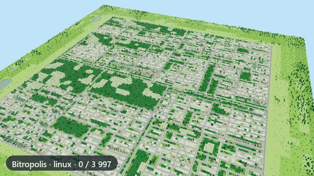
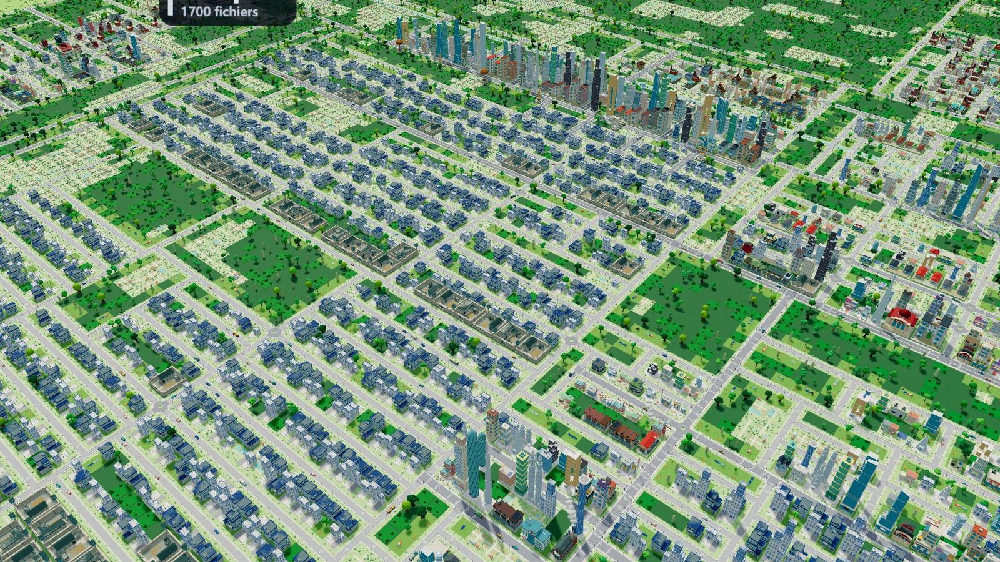
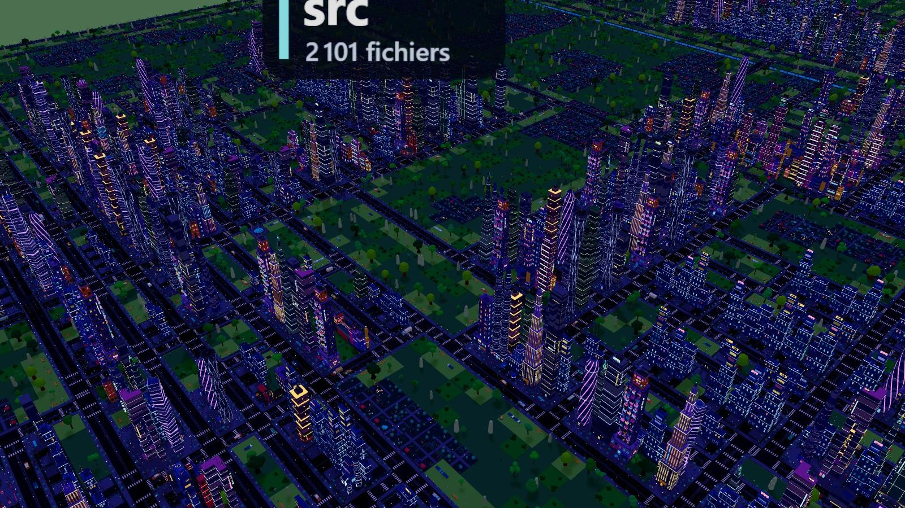
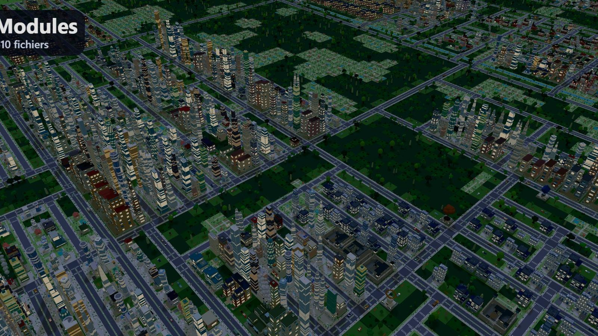
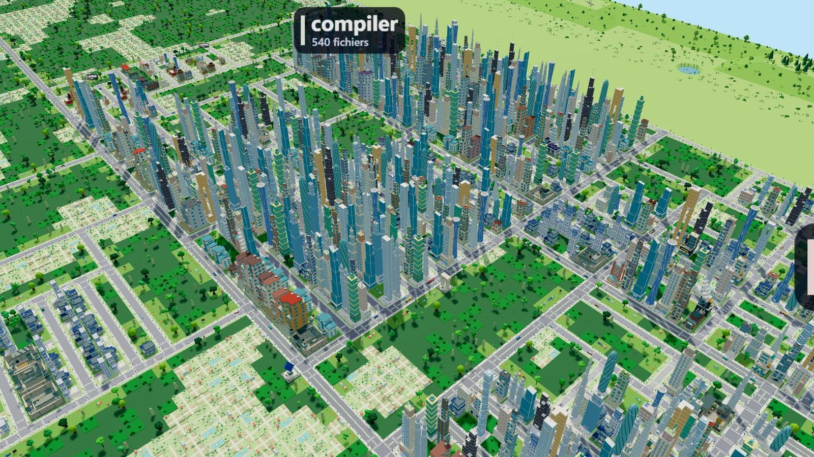
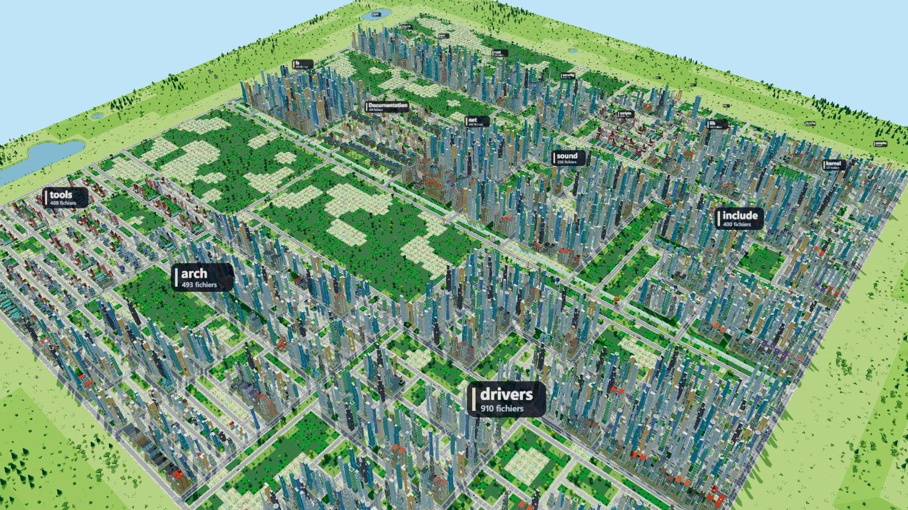
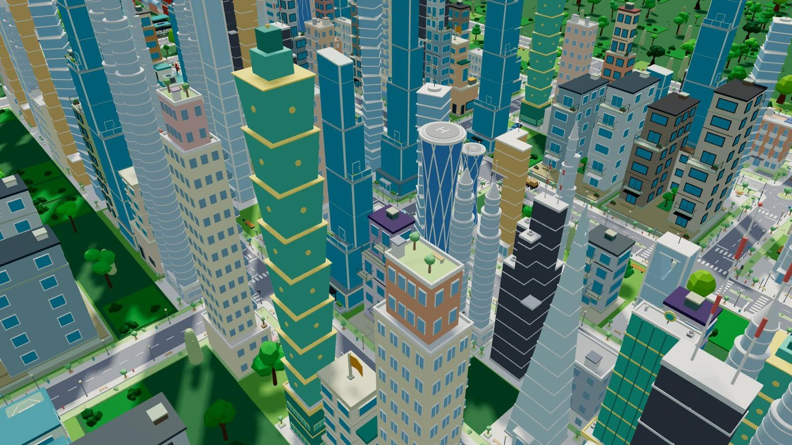
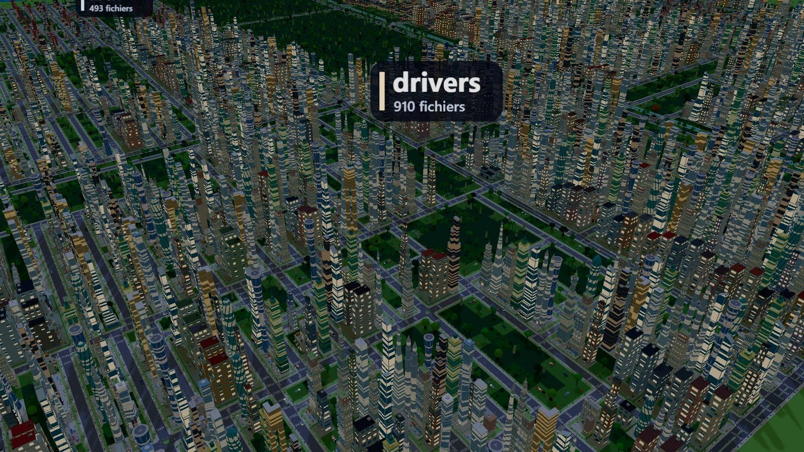
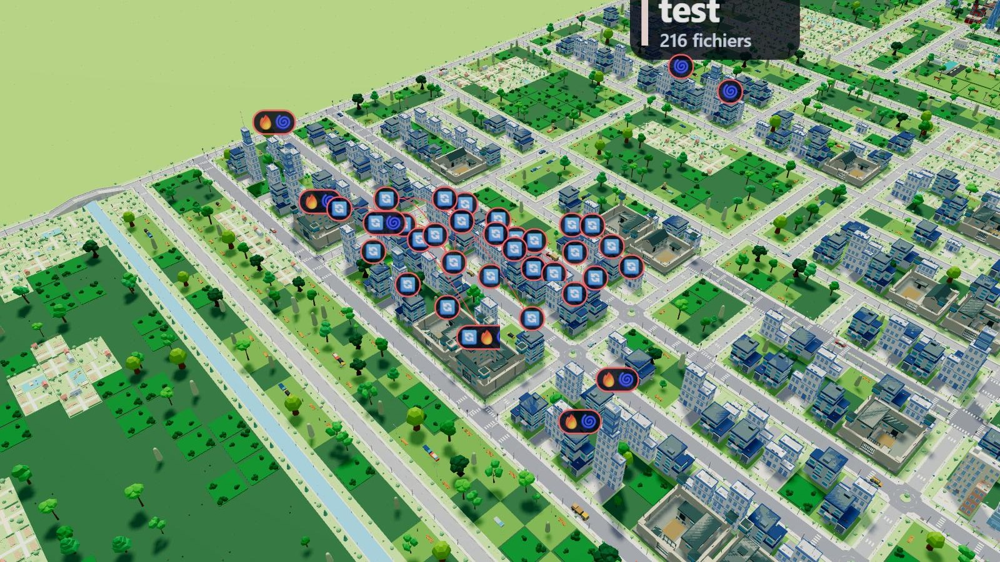

<div align="center">

[Français](README.md) · [English](README.en.md) · [Español](README.es.md) · **Deutsch**

# 🏙️ BITROPOLIS

### Dein Code wird zu einer Stadt, die mit ihm wächst.

Jeder Ordner ist ein Viertel, jede Datei ein Gebäude, jede Abhängigkeit eine Straße.
Je größer eine Datei wird, desto weiter steigt ihr Gebäude auf.

[](https://kila86508.github.io/Bitropolis/dist/bitropolis.html)
[](#-100--lokal-wirklich)
[](https://nodejs.org)
[](https://www.npmjs.com/package/bitropolis)
[](LICENSE)



</div>

## ✨ Auf einen Blick

- 🏗️ **Eine lebendige Stadt**: Low-Poly-Gebäude mit 8 Ausbaustufen, Straßen in 4 Größen, ein Fluss mit Brücken, Kreisverkehre, Verkehr mit Ampeln und Staus, Tag und Nacht.
- 🐧 **Auch für riesige Projekte**: Der Linux-Kernel (97.000 Dateien) wird zu einer flüssigen Stadt, gebaut in Sekunden.
- 📈 **Sie entwickelt sich mit deinem Code**: Bei jeder neuen Generierung steigen die Gebäude der gewachsenen Dateien vor deinen Augen auf.
- 🌄 **Eine eigene Karte pro Projekt**: prozedurale Landschaft (Hügel, Seen, Wälder) auf einem Diorama-Sockel.
- 🔒 **100 % lokal**: eine einzige HTML-Datei, keine Netzwerkanfragen, keine einzige Zeile deines Codes kopiert.
- 🩺 **Ein echtes Werkzeug**: Der Gesundheitsmodus findet riesige Dateien, Import-Zyklen, toten Code und angehäufte TODOs.
- 🎬 **Zum Teilen**: Exportiere deine Stadt als Bild, animiertes GIF oder Zeitraffer-Video ihres Baus.

## 🗺️ Das Prinzip

| In deinem Code | In der Stadt |
|---|---|
| 📁 Ordner | 🏘️ Viertel, mit Schild |
| 📄 Datei | 🏢 Gebäude, mit der Fassade zur Straße |
| 📏 Größe und Rolle der Datei | 🏗️ Ausbaustufe: von N1 (Hütte) bis N8 (Turm) |
| 🔗 Imports zwischen Dateien | 🛣️ Straßen und Verkehr: die meistbefahrenen Alleen werden ausgebaut |
| 🚀 Einstiegspunkt (`main`, `index`, `app`…) | 🏛️ Rathaus, nur eines |

### 🏛️ Ein Gebäudetyp pro Rolle

| Gebäude | Dateien |
|---|---|
| 🏛️ **Rathaus** | Der Haupteinstiegspunkt |
| 🏢 **Wohnhäuser, Büros** | Der Kern-Quellcode |
| 🛍️ **Läden, Theater** | Die Oberfläche: Komponenten, Views, Seiten, CSS |
| 🏦 **Büros, Forschungszentren** | Die Daten: Modelle, Schemas, Stores, Typen |
| 🚓 **Polizeiwache** | Tests und Sicherheit |
| 🚒 **Feuerwache, Busbahnhof** | CI/CD, Docker, Skripte, Deployment |
| 🏥 **Klinik → Krankenhaus** | Fehler, Logs, Monitoring |
| 📚 **Bibliothek, Schule, Uhrturm** | Die Dokumentation |
| 🏭 **Werkstatt → Fabrik → Industriekomplex** | Konfiguration und Werkzeuge |
| ⚡ **Wind → Solar → Kohle → Atom** | Die Abhängigkeiten (`package.json`, `Cargo.toml`…) |
| 💧 **Wasserturm → Kläranlage** | Rohdaten: SQL, CSV, Migrationen |
| 🌳 **Park, Brunnen, Denkmal** | Die Assets: Bilder, Sounds, Schriften |

## 🏙️ Berühmte Städte

Einige große Open-Source-Projekte, so wie Bitropolis sie sieht.

<table>
  <tr>
    <td width="50%"><br><sub><b>⚛️ React</b>: eine Stadt aus Polizeiwachen. Tausende Tests werden zu ganzen Vierteln.</sub></td>
    <td width="50%"><br><sub><b>🌃 VS Code</b> im Cyberpunk-Thema: 21.600 Dateien, 22.660 Verknüpfungen.</sub></td>
  </tr>
  <tr>
    <td width="50%"><br><sub><b>🐍 CPython</b> bei Nacht: <code>Modules</code>, <code>Objects</code>, <code>Lib</code>…</sub></td>
    <td width="50%"><br><sub><b>🦀 Rust</b>: Das Viertel <code>compiler</code> ist eine echte Innenstadt.</sub></td>
  </tr>
</table>

Um sie bei dir anzusehen (flacher Klon der neuesten Version, dann die Stadt):

```bash
git clone --depth 1 https://github.com/facebook/react.git
npx bitropolis react

git clone --depth 1 https://github.com/microsoft/vscode.git
npx bitropolis vscode

git clone --depth 1 https://github.com/python/cpython.git
npx bitropolis cpython

git clone --depth 1 https://github.com/rust-lang/rust.git
npx bitropolis rust

git clone --depth 1 https://github.com/torvalds/linux.git
npx bitropolis linux
```

> Jede Stadt entsteht in 1 bis 12 Sekunden und behält 4.000 repräsentative Gebäude, egal wie viele Dateien es sind.

## 🏗️ Eine Stadt, die mit deinem Code wächst

- **Stufen N1 → N8.** Jede Datei folgt einer Kette von Gebäuden, die unterwegs die Familie wechseln kann (*Klinik → Krankenhaus*, *Windrad → Atomkraftwerk*…). Die Stufe ist **absolut**: 1 Zeile = 1 Punkt, +15 pro Datei, die sie importiert, plus Komplexität. Eine Datei schrumpft also nie, nur weil andere wachsen. Die Gebäudekarte zeigt den Fortschritt zur nächsten Stufe.
- **Entwicklung.** Bei jeder Generierung vergleicht Bitropolis mit der vorherigen: Die CLI liest die alte `index.html`, der Browser merkt sich deinen letzten Besuch. Gewachsene Gebäude und neue Dateien steigen aus dem Boden, mit einer Beschriftung wie „Résidence N3 → N4“.
- **Straßen N1 → N8.** Jede Abhängigkeit zwischen zwei Vierteln wird über den kürzesten Straßenweg geführt. Die meistbefahrenen Alleen werden zu beleuchteten Boulevards, und auf ihren Plätzen entstehen Denkmäler.
- **Vielfalt.** Mehrere Familien und Farbvarianten pro Dateityp, umgefärbte Paletten, gespiegelte Gebäude, Gärten, kleine Plätze und Parkplätze: Keine zwei Projekte sehen gleich aus.
- **Leben.** Ein Fluss durchquert die Stadt, jede Straße überquert ihn mit einer Brücke. Ampeln, Rechts-vor-links, Kreisverkehre, Überführungen an den großen Kreuzungen; drehende Windräder, rauchende Schornsteine, sprudelnde Brunnen.

## 🚀 Verwendung

### Option 1: ohne Installation

Öffne die **[Live-Demo](https://kila86508.github.io/Bitropolis/dist/bitropolis.html)** oder lokal [`dist/bitropolis.html`](dist/bitropolis.html) (Doppelklick), dann **ziehe deinen Ordner hinein** oder klicke auf „📁 Code-Ordner öffnen“. Alles passiert in deinem Browser: Nichts wird hochgeladen. Die Live-Demo ist absichtlich ein kleines Projekt, damit sie im Nu startet; dein eigenes Projekt darf riesig sein (ein Fortschrittsbalken begleitet den Import).

### Option 2: Kommandozeile (Node.js ≥ 18)

```bash
npx bitropolis ~/code/mein-projekt
```

Oder aus dem Quellcode:

```bash
git clone https://github.com/Kila86508/Bitropolis.git
cd Bitropolis
npm install
node bin/bitropolis.js ~/code/mein-projekt
```

Die Stadt wird nach `bitropolis-city/index.html` geschrieben und öffnet sich automatisch. Führe nach dem Programmieren denselben Befehl erneut aus: Die gewachsenen Gebäude erwachen zum Leben.

```text
bitropolis [ordner] [optionen]
  -o, --out <datei>     Zu erzeugende HTML-Datei (Standard: ./bitropolis-city/index.html)
  -n, --name <name>     Name der Stadt
      --json            Exportiert zusätzlich die Rohanalyse (.city.json)
      --no-open         Browser nicht öffnen
  -l, --lang <xx>       Sprache: en, fr, de, it, es, zh, ru
```

Die erzeugte Datei ist **eigenständig**: Schick sie einem Freund, sie öffnet sich ohne Server und ohne Internet.

### 🎮 Steuerung

| Aktion | Maus / Tastatur |
|---|---|
| Drehen | Ziehen (Linksklick) |
| Verschieben | Rechtsklick oder `WASD` / `ZQSD` / Pfeiltasten |
| Zoomen | Mausrad, `+` / `-` |
| Gebäudeinfo | Klick |
| Hinfliegen | Doppelklick |
| Datei suchen | `/` |
| Auswahl aufheben | `Esc` |

Werkzeugleiste: 🌙 Tag / Nacht · 🔗 alle Abhängigkeiten · 🚗 Verkehr · 🏷️ Viertel · 🎯 zentrieren · 🎲 neue Landschaft · 🩺 Code-Gesundheit · 📸 Export (Bild, GIF, Video) · Thema · Sprache.

> 🌐 Oberfläche und CLI sprechen **Deutsch, Englisch, Französisch, Italienisch, Spanisch, Chinesisch und Russisch**: Die Sprache des Browsers (bzw. des Systems) wird automatisch gewählt, über das Sprachmenü in der Werkzeugleiste lässt sie sich ändern.

## 🐧 Und bei einem riesigen Projekt? Der Linux-Kernel



<table>
  <tr>
    <td width="50%"><br><sub><b>🏙️ Innenstadt</b>: Die wichtigsten und meistimportierten Dateien werden zu Wolkenkratzern.</sub></td>
    <td width="50%"><br><sub><b>🌃 Bei Nacht</b>: Tausende Türme, Stockwerk für Stockwerk beleuchtet.</sub></td>
  </tr>
</table>

Der Linux-Kernel umfasst **97.000 Dateien**. Bitropolis geht alle durch, behält **4.000 repräsentative** (jeder große Ordner bekommt seinen Anteil: `drivers`, `arch`, `kernel`, `mm`, `net`…), verknüpft die `#include`s (**fast 5.900 Verknüpfungen**) und baut die Stadt **in 7 Sekunden**. Auf dem Bildschirm werden nur sichtbare Gebäude gezeichnet, entfernte in vereinfachter Form: Die Stadt bleibt flüssig.

Zum Selberbauen:

```bash
git clone --depth 1 https://github.com/torvalds/linux.git
npx bitropolis linux
```

## 🩺 Code-Gesundheit



Der Knopf **🩺 Gesundheit** zeigt über den Gebäuden, was einen Blick verdient, und öffnet einen Bericht, in dem jede Datei anklickbar ist:

| Symbol | Problem | Regel |
|---|---|---|
| 🔥 | Riesige Datei | 1.000 Codezeilen oder mehr |
| 🔄 | Zirkuläre Abhängigkeit | die Datei ist Teil eines Import-Zyklus (rote Bögen in der Stadt) |
| 🌀 | Sehr komplex | 150 Verzweigungen oder mehr (`if`, `for`, `&&`…) |
| 🚧 | Angehäufte TODO / FIXME | 5 oder mehr |
| 👻 | Nie importiert | vielleicht toter Code (außer Einstiegspunkten, Tests und Skripten) |

Die Karte jedes Gebäudes listet auch seine Warnungen auf. Bei VS Code findet Bitropolis zum Beispiel 63 Import-Zyklen, einer davon mit 16 Dateien.

## 🎬 Deine Stadt exportieren

Der Knopf **📸** bietet drei Exporte, alle in deinem Browser berechnet:

- 🖼️ **PNG-Bild** der aktuellen Ansicht;
- 🎞️ **Animiertes GIF**: eine volle Runde um die Stadt (512 × 288, in Schleife);
- 🎬 **Zeitraffer-Video** (MP4 oder WebM, je nach Browser): Die Gebäude wachsen eins nach dem anderen aus dem Boden, vom Rathaus nach außen, während die Kamera kreist.

## 🔒 100 % lokal, wirklich

- Keine Netzwerkanfragen: three.js und die 3D-Modelle sind in die HTML-Datei **eingebettet**. Kein CDN, keine Analytics.
- Die erzeugte Datei enthält **keinen Code von dir**: nur Dateipfade und Zahlen (Zeilen, Verknüpfungen, Stufen).
- `node_modules`, `.git`, `dist`, `build`, versteckte Ordner und alles, was in deiner `.gitignore` steht, werden übersprungen.

## 🧠 Unterstützte Sprachen

Verknüpfungen zwischen Dateien werden erkannt für **JavaScript / TypeScript** (ESM, CommonJS, `@/`-Aliase), **Python**, **Go**, **Rust**, **Java / Kotlin / Scala**, **C / C++**, **C#**, **PHP**, **Ruby**, **Dart**, **Lua**, **CSS / SCSS / Less**, **HTML** und **Vue / Svelte / Astro**. Alle anderen Dateien werden trotzdem zu Gebäuden.

## 🎨 Themen

| Thema | Status |
|---|---|
| 🏙️ 3D-Stadt (Raster, wachsende Gebäude, Verkehr) | ✅ Standard |
| 🔺 Low Poly (prozedurale Gebäude) | ✅ verfügbar |
| 🌃 Cyberpunk (Neon, immer Nacht) | ✅ verfügbar |
| 🏰 Mittelalter · 👾 Pixel-Art · ⛩️ Japan | 🔜 demnächst |

<p align="center"><br><sub>🌃 Das Cyberpunk-Thema: dieselbe Stadt, in Neon, bei Nacht.</sub></p>


Ein Thema verändert weder die Analyse noch den Stadtplan: Es beschreibt nur, wie die Gebäude aussehen. Siehe [`docs/THEMES.md`](docs/THEMES.md), um eines zu erstellen.

## 🗂️ Architektur

```text
bin/bitropolis.js          CLI: scannt einen Ordner → eigenständige HTML-Datei
src/core/analyze.js        Metriken, Imports, Wichtigkeit, Gebäudetyp
src/core/catalog.js        Gebäudeketten, Stufen N1→N8, Entwicklung zwischen zwei Scans
src/core/grid.js           Rasterstadtplanung: Blöcke, Straßenkacheln, Verkehrsrouten, Stadtmöbel
src/core/layout.js         Stadtplanung des Low-Poly-Themas
src/core/terrain.js        prozedurale Landschaft: Relief, Wasser, Vegetation
src/core/obf.js            Verschlüsselung der eingebetteten Modelle
src/viewer/render.js       3D-Engine (three.js), Nacht, Animationen, Entwicklung
src/viewer/traffic.js      Verkehr: Fahrspuren, Abstände, Ampeln, Rechts-vor-links
src/viewer/citypack.js     Darstellung der Stadt (InstancedMesh, Paletten, Lichter)
src/viewer/landscape.js    Darstellung von Landschaft und Diorama-Sockel
src/viewer/ui.js           Oberfläche, Suche, Drag-and-Drop
src/viewer/export.js       GIF-Export (eigener Encoder) und Zeitraffer-Video
scripts/assets.js          wandelt Modelle (.glb, .obj) in kompakte verschlüsselte Daten um
scripts/build.js           baut dist/bitropolis.html
```

Der Kern (`src/core`) hat keine Abhängigkeiten und läuft sowohl in Node als auch im Browser.

```bash
npm test         # Tests (Stadtplanung, Wachstum, Verkehr…)
npm run build    # baut dist/bitropolis.html neu
```

> 🔐 Die Original-3D-Modelle werden nicht veröffentlicht: Nur ihre verschlüsselte Fassung ist in `dist/bitropolis.html` eingebettet und wird ausschließlich im Speicher entschlüsselt. Fehlen die Modelle, übernimmt `npm run build` das bereits in `dist/` vorhandene verschlüsselte Paket. So kann jeder Bitropolis bauen und seine Stadt erstellen.

## 🛣️ Roadmap

- [x] Rasterstadt mit wachsenden Gebäuden und gestuften Straßen
- [x] Verkehr, Ampeln, Rechts-vor-links
- [x] Animierte Entwicklung zwischen zwei Generierungen
- [x] Fluss, Brücken, Überführungen und Kreisverkehre
- [x] Riesige Projekte: repräsentative Auswahl, Detailstufen
- [x] Code-Gesundheit: riesige Dateien, Import-Zyklen, toter Code
- [x] Export als Bild, animiertes GIF und Zeitraffer-Video
- [ ] Git-Historie: zusehen, wie die Stadt Commit für Commit entsteht
- [ ] Ego-Perspektive zum „Spazierengehen“
- [ ] Wetter je nach Projektzustand (TODOs, fehlschlagende Tests…)
- [x] Cyberpunk-Thema
- [ ] Themen Mittelalter und Pixel-Art

## 📄 Lizenz

Der **Code** steht unter der [MIT](LICENSE)-Lizenz: Mach damit, was du willst, und zeig uns deine Stadt!
Die eingebetteten **3D-Modelle** bleiben Eigentum ihres Urhebers und fallen nicht unter diese Lizenz.
