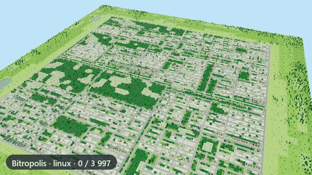
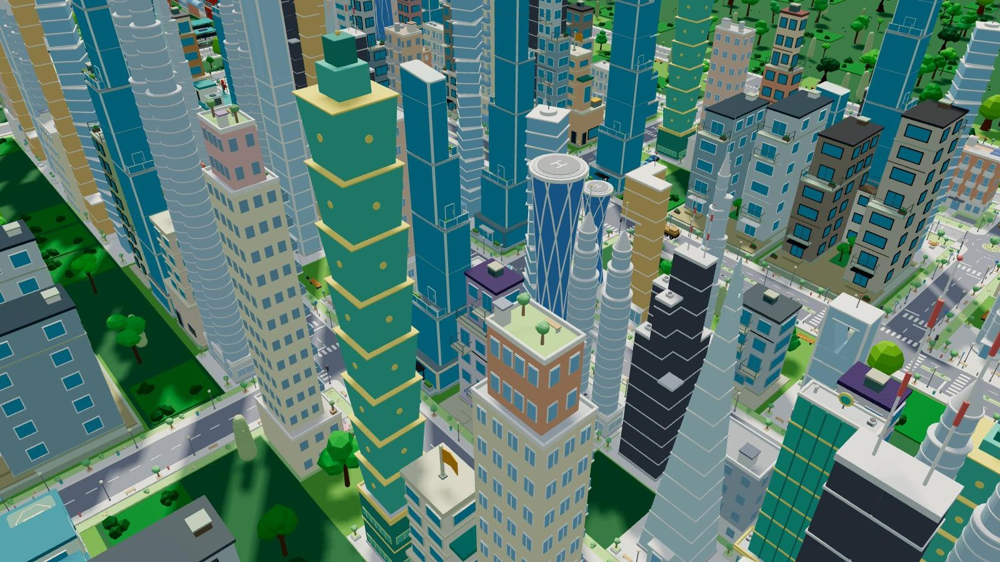

<div align="center">

[Français](README.md) · **English** · [Español](README.es.md) · [Deutsch](README.de.md)

# 🏙️ BITROPOLIS

### Your code becomes a city that grows with it.

Every folder is a district, every file a building, every dependency a road.
The bigger a file gets, the more its building levels up.

[](https://kila86508.github.io/Bitropolis/dist/bitropolis.html)
[](#-100-local-for-real)
[](https://nodejs.org)
[](https://www.npmjs.com/package/bitropolis)
[](LICENSE)



</div>

## ✨ At a glance

- 🏗️ **A living city**: low poly buildings with 8 growth stages, 4 road sizes, a river with bridges, roundabouts, traffic with lights and jams, day and night.
- 🐧 **Even for a huge project**: the Linux kernel (97,000 files) becomes a smooth city, built in seconds.
- 📈 **It evolves with your code**: every time you regenerate, the files that grew level up their building right in front of you.
- 🌄 **A unique map per project**: procedural countryside (hills, lakes, forests) on a diorama base.
- 🔒 **100% local**: one single HTML file, no network requests, not a single line of your code copied.
- 🩺 **A real tool**: the Health mode spots huge files, import cycles, dead code and piled-up TODOs.
- 🎬 **Made to share**: export your city as an image, an animated GIF or a timelapse video of its construction.

## 🗺️ How it works

| In your code | In the city |
|---|---|
| 📁 Folder | 🏘️ District, with its sign |
| 📄 File | 🏢 Building, facing the street |
| 📏 File size and role | 🏗️ Building stage: from N1 (shack) to N8 (tower) |
| 🔗 Imports between files | 🛣️ Roads and traffic: the busiest avenues get upgraded |
| 🚀 Entry point (`main`, `index`, `app`…) | 🏛️ City hall, only one |

### 🏛️ One building type per role

| Building | Files |
|---|---|
| 🏛️ **City hall** | The main entry point |
| 🏢 **Homes, offices** | Core source code |
| 🛍️ **Shops, theaters** | User interface: components, views, pages, CSS |
| 🏦 **Offices, research centers** | Data: models, schemas, stores, types |
| 🚓 **Police station** | Tests and security |
| 🚒 **Fire station, bus depot** | CI/CD, Docker, scripts, deployment |
| 🏥 **Clinic → hospital** | Errors, logs, monitoring |
| 📚 **Library, school, clock tower** | Documentation |
| 🏭 **Workshop → factory → industrial complex** | Configuration and tooling |
| ⚡ **Wind → solar → coal → nuclear** | Dependency manifests (`package.json`, `Cargo.toml`…) |
| 💧 **Water tower → treatment plant** | Raw data: SQL, CSV, migrations |
| 🌳 **Park, fountain, memorial** | Assets: images, sounds, fonts |

## 🏙️ Famous cities

A few big open source projects, as Bitropolis sees them.

<table>
  <tr>
    <td width="50%"><br><sub><b>⚛️ React</b>: a city of police stations. Its thousands of tests become whole districts.</sub></td>
    <td width="50%"><br><sub><b>🌃 VS Code</b>, in the Cyberpunk theme: 21,600 files, 22,660 links.</sub></td>
  </tr>
  <tr>
    <td width="50%"><br><sub><b>🐍 CPython</b>, at night: <code>Modules</code>, <code>Objects</code>, <code>Lib</code>…</sub></td>
    <td width="50%"><br><sub><b>🦀 Rust</b>: the <code>compiler</code> district is a true downtown.</sub></td>
  </tr>
</table>

To see them on your machine (shallow clone of the latest version, then the city):

```bash
git clone --depth 1 https://github.com/facebook/react.git
npx bitropolis react

git clone --depth 1 https://github.com/microsoft/vscode.git
npx bitropolis vscode

git clone --depth 1 https://github.com/python/cpython.git
npx bitropolis cpython

git clone --depth 1 https://github.com/rust-lang/rust.git
npx bitropolis rust

git clone --depth 1 https://github.com/torvalds/linux.git
npx bitropolis linux
```

> Each city builds in 1 to 12 seconds and keeps 4,000 representative buildings, whatever the number of files.

## 🏗️ A city that grows with your code

- **Stages N1 → N8.** Every file follows a chain of buildings, which can switch family along the way (*clinic → hospital*, *wind turbine → nuclear plant*…). The stage is **absolute**: 1 line = 1 point, +15 per file that imports it, plus complexity. A file never shrinks just because others grow. The building card shows the progress toward the next stage.
- **Evolution.** On every generation, Bitropolis compares with the previous one: the CLI reads the old `index.html`, the browser remembers your last visit. Buildings that grew and new files rise from the ground, with a label like “Résidence N3 → N4”.
- **Roads N1 → N8.** Every dependency between two districts is routed along the shortest road path. The busiest avenues become lit boulevards, and monuments settle on their squares.
- **Variety.** Several families and color variants per file type, recolored palettes, mirrored buildings, gardens, small squares and parking lots: no two projects look alike.
- **Life.** A river crosses the city and every street spans it with a bridge. Traffic lights, right-of-way, roundabouts, overpasses on the big crossroads; spinning wind turbines, smoking chimneys, splashing fountains.

## 🚀 Usage

### Option 1: nothing to install

Open the **[live demo](https://kila86508.github.io/Bitropolis/dist/bitropolis.html)**, or [`dist/bitropolis.html`](dist/bitropolis.html) locally (double-click), then **drag and drop your folder** or click “📁 Open a code folder”. Everything happens in your browser: nothing is uploaded. The live demo is deliberately a small project so it opens in a blink; your own project can be huge (a progress bar follows the import).

### Option 2: command line (Node.js ≥ 18)

```bash
npx bitropolis ~/code/my-project
```

Or from source:

```bash
git clone https://github.com/Kila86508/Bitropolis.git
cd Bitropolis
npm install
node bin/bitropolis.js ~/code/my-project
```

The city is written to `bitropolis-city/index.html` and opens automatically. Run the same command again after coding: the buildings that grew come alive.

```text
bitropolis [folder] [options]
  -o, --out <file>      HTML file to create (default: ./bitropolis-city/index.html)
  -n, --name <name>     City name
      --json            Also export the raw analysis (.city.json)
      --no-open         Do not open the browser
  -l, --lang <xx>       Language: en, fr, de, it, es, zh, ru
```

The generated file is **self-contained**: send it to a friend, it opens without a server or Internet access.

### 🎮 Controls

| Action | Mouse / keyboard |
|---|---|
| Rotate | Drag (left click) |
| Pan | Right click, or `WASD` / `ZQSD` / arrows |
| Zoom | Mouse wheel, `+` / `-` |
| Building info | Click |
| Fly to | Double-click |
| Search a file | `/` |
| Deselect | `Esc` |

Toolbar: 🌙 day / night · 🔗 all dependencies · 🚗 traffic · 🏷️ districts · 🎯 recenter · 🎲 new countryside · 🩺 code health · 📸 export (image, GIF, video) · theme · language.

> 🌐 The interface and the CLI speak **English, French, German, Italian, Spanish, Chinese and Russian**: your browser (or system) language is picked automatically, and the language menu in the toolbar switches it.

## 🐧 What about a huge project? The Linux kernel


<table>
  <tr>
    <td width="50%"><br><sub><b>🏙️ Downtown</b>: the most important, most imported files become skyscrapers.</sub></td>
    <td width="50%"><br><sub><b>🌃 At night</b>: thousands of towers, lit floor by floor.</sub></td>
  </tr>
</table>

The Linux kernel is **97,000 files**. Bitropolis walks through all of them, keeps **4,000 representative ones** (every big folder gets its share: `drivers`, `arch`, `kernel`, `mm`, `net`…), links the `#include`s (**almost 5,900 links**) and builds the city **in 7 seconds**. On screen, only visible buildings are drawn, distant ones in a simplified version: the city stays smooth.

To build it yourself:

```bash
git clone --depth 1 https://github.com/torvalds/linux.git
npx bitropolis linux
```

## 🩺 Code health


The **🩺 Health** button shows, above the buildings, what deserves a look, and opens a report where every file is clickable:

| Icon | Issue | Rule |
|---|---|---|
| 🔥 | Huge file | 1,000 lines of code or more |
| 🔄 | Circular dependency | the file is part of an import cycle (red arcs in the city) |
| 🌀 | Very complex | 150 branches or more (`if`, `for`, `&&`…) |
| 🚧 | Piled-up TODO / FIXME | 5 or more |
| 👻 | Never imported | possibly dead code (entry points, tests and scripts excluded) |

Each building's card also lists its warnings. On VS Code, for example, Bitropolis finds 63 import cycles, one of them 16 files long.

## 🎬 Export your city

The **📸** button offers three exports, all computed in your browser:

- 🖼️ **PNG image** of the current view;
- 🎞️ **Animated GIF**: a full turn around the city (512 × 288, looping);
- 🎬 **Timelapse video** (MP4 or WebM depending on the browser): buildings rise one by one, from the city hall outwards, while the camera circles.

## 🔒 100% local, for real

- No network requests: three.js and the 3D models are **embedded** in the HTML. No CDN, no analytics.
- The generated file contains **none of your code**: only file paths and numbers (lines, links, stages).
- `node_modules`, `.git`, `dist`, `build`, hidden folders and whatever your `.gitignore` lists are skipped.

## 🧠 Supported languages

Links between files are detected for **JavaScript / TypeScript** (ESM, CommonJS, `@/` aliases), **Python**, **Go**, **Rust**, **Java / Kotlin / Scala**, **C / C++**, **C#**, **PHP**, **Ruby**, **Dart**, **Lua**, **CSS / SCSS / Less**, **HTML** and **Vue / Svelte / Astro**. Every other file still becomes a building.

## 🎨 Themes

| Theme | Status |
|---|---|
| 🏙️ 3D City (grid, growing buildings, traffic) | ✅ default |
| 🔺 Low poly (procedural buildings) | ✅ available |
| 🌃 Cyberpunk (neon, always night) | ✅ available |
| 🏰 Medieval · 👾 Pixel art · ⛩️ Japan | 🔜 coming soon |

<p align="center"><br><sub>🌃 The Cyberpunk theme: the same city, in neon, at night.</sub></p>


A theme touches neither the analysis nor the city plan: it only describes what buildings look like. See [`docs/THEMES.md`](docs/THEMES.md) to create one.

## 🗂️ Architecture

```text
bin/bitropolis.js          CLI: scans a folder → self-contained HTML
src/core/analyze.js        metrics, imports, importance, building type
src/core/catalog.js        building chains, N1→N8 stages, evolution between two scans
src/core/grid.js           grid city planning: blocks, road tiles, routed traffic, street furniture
src/core/layout.js         city planning for the low poly theme
src/core/terrain.js        procedural countryside: relief, water, vegetation
src/core/obf.js            scrambling of the embedded models
src/viewer/render.js       3D engine (three.js), night, animations, evolution
src/viewer/traffic.js      traffic: lanes, distances, lights, right-of-way
src/viewer/citypack.js     city rendering (InstancedMesh, palettes, lights)
src/viewer/landscape.js    countryside and diorama base rendering
src/viewer/ui.js           interface, search, drag and drop
src/viewer/export.js       GIF export (home-made encoder) and timelapse video
scripts/assets.js          converts models (.glb, .obj) into compact encrypted data
scripts/build.js           builds dist/bitropolis.html
```

The core (`src/core`) has no dependencies and runs both in Node and in the browser.

```bash
npm test         # tests (city planning, growth, traffic…)
npm run build    # rebuilds dist/bitropolis.html
```

> 🔐 The original 3D models are not published: only their encrypted version is embedded in `dist/bitropolis.html`, and it is only decrypted in memory. If the models are missing, `npm run build` reuses the encrypted pack already in `dist/`, so anyone can build Bitropolis and create their city.

## 🛣️ Roadmap

- [x] Grid city with growing buildings and tiered roads
- [x] Traffic, traffic lights, right-of-way
- [x] Animated evolution between two generations
- [x] River, bridges, overpasses and roundabouts
- [x] Huge projects: representative selection, levels of detail
- [x] Code health: huge files, import cycles, dead code
- [x] Image, animated GIF and timelapse video export
- [ ] Git history: watch the city being built commit by commit
- [ ] First-person “walk” mode
- [ ] Weather based on project health (TODOs, failing tests…)
- [x] Cyberpunk theme
- [ ] Medieval and pixel art themes

## 📄 License

The **code** is released under the [MIT](LICENSE) license: do whatever you want with it, and show us your city!
The embedded **3D models** remain the property of their author and are not covered by this license.
