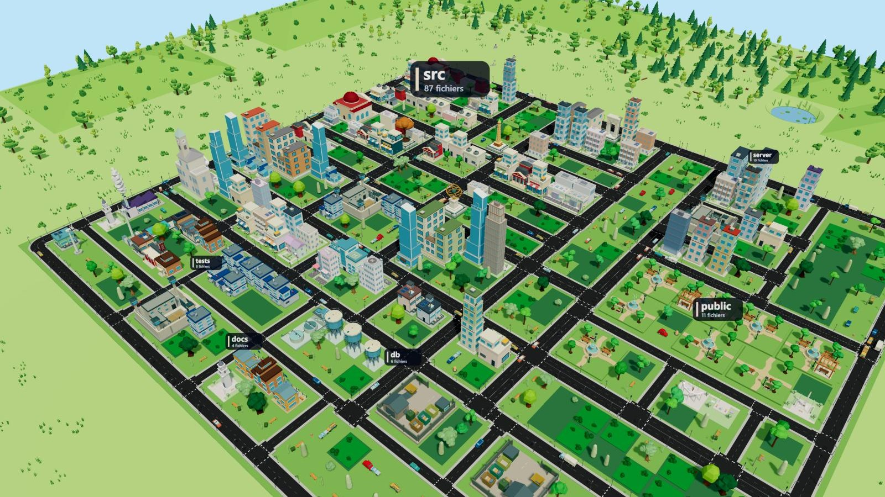
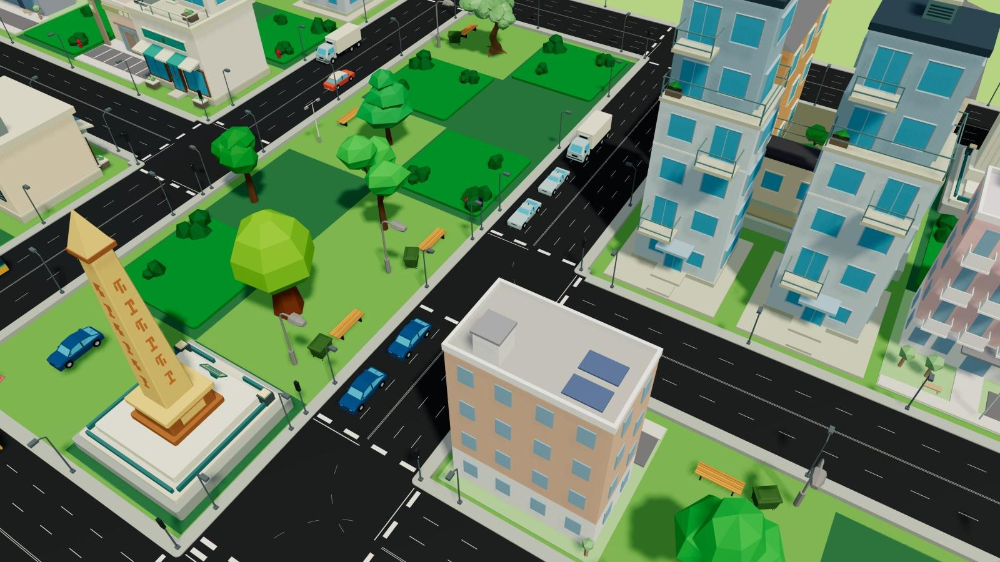
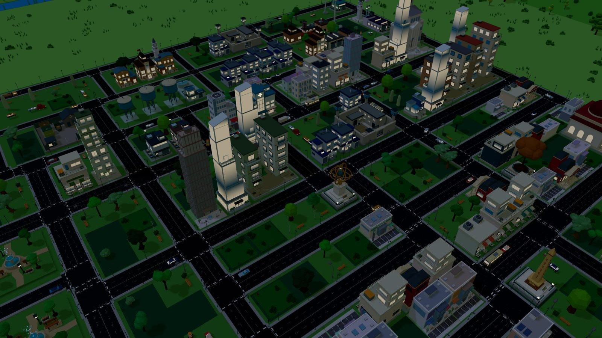
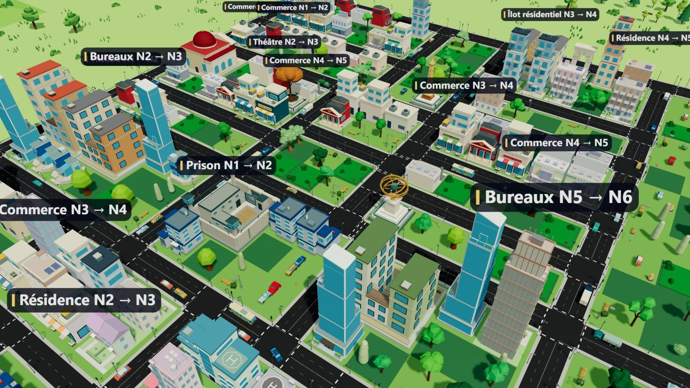
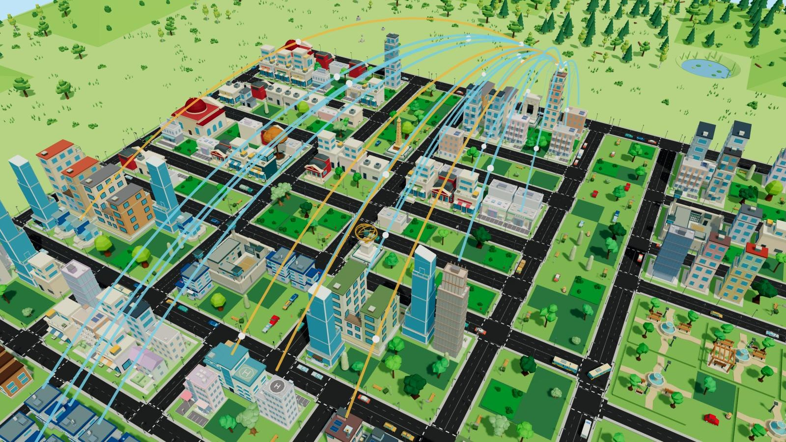
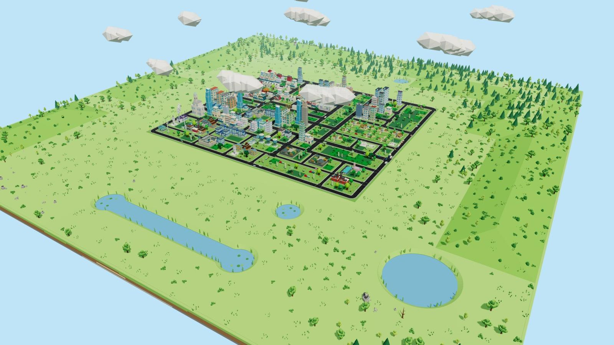
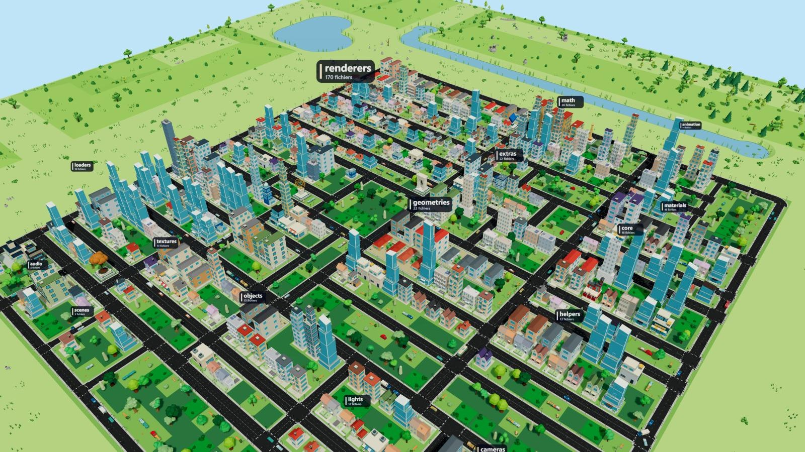
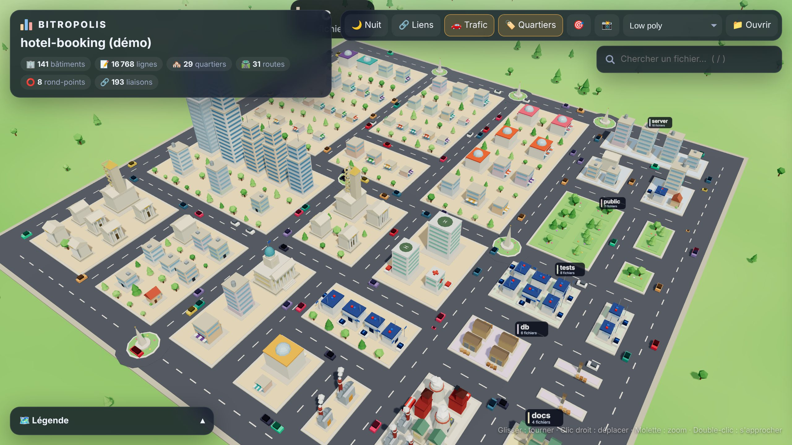

<div align="center">

[Français](README.md) · **English** · [Español](README.es.md) · [Deutsch](README.de.md)

# 🏙️ BITROPOLIS

### Your code becomes a city that grows with it.

Every folder is a district, every file a building, every dependency a road.
The bigger a file gets, the more its building levels up.

[](https://kila86508.github.io/Bitropolis/dist/bitropolis.html)
[](#-100-local-for-real)
[](https://nodejs.org)
[](LICENSE)



</div>

## ✨ At a glance

- 🏗️ **A living city**: low poly buildings with 8 growth stages, 8 road tiers, traffic with lights and jams, day and night.
- 📈 **It evolves with your code**: every time you regenerate, the files that grew level up their building right in front of you.
- 🌄 **A unique map per project**: procedural countryside (hills, lakes, forests) on a diorama base.
- 🔒 **100% local**: one single HTML file, no network requests, not a single line of your code copied.

## 🗺️ How it works

| In your code | In the city |
|---|---|
| 📁 Folder | 🏘️ District, with its sign |
| 📄 File | 🏢 Building, facing the street |
| 📏 File size and role | 🏗️ Building stage: from N1 (shack) to N8 (tower) |
| 🔗 Imports between files | 🛣️ Roads and traffic: the busiest avenues get upgraded |
| 🚀 Entry point (`main`, `index`, `app`…) | 🏛️ City hall, only one |

### 🏛️ One building type per role

| Building | Files |
|---|---|
| 🏛️ **City hall** | The main entry point |
| 🏢 **Homes, offices** | Core source code |
| 🛍️ **Shops, theaters** | User interface: components, views, pages, CSS |
| 🏦 **Offices, research centers** | Data: models, schemas, stores, types |
| 🚓 **Police station** | Tests and security |
| 🚒 **Fire station, bus depot** | CI/CD, Docker, scripts, deployment |
| 🏥 **Clinic → hospital** | Errors, logs, monitoring |
| 📚 **Library, school, clock tower** | Documentation |
| 🏭 **Workshop → factory → industrial complex** | Configuration and tooling |
| ⚡ **Wind → solar → coal → nuclear** | Dependency manifests (`package.json`, `Cargo.toml`…) |
| 💧 **Water tower → treatment plant** | Raw data: SQL, CSV, migrations |
| 🌳 **Park, fountain, memorial** | Assets: images, sounds, fonts |

## 📸 Gallery

<table>
  <tr>
    <td width="50%"><br><sub><b>🚦 Traffic</b>: cars drive on the right, keep their distance and stop at red lights.</sub></td>
    <td width="50%"><br><sub><b>🌙 Night</b>: street lamps turn on, windows switch on and off floor by floor.</sub></td>
  </tr>
  <tr>
    <td width="50%"><br><sub><b>📈 Evolution</b>: whatever grew since the last generation rises from the ground with its new stage.</sub></td>
    <td width="50%"><br><sub><b>🔗 Dependencies</b>: click a building to see what it uses (orange) and who uses it (blue).</sub></td>
  </tr>
</table>


<p align="center"><sub><b>🌄 The diorama</b>: every project gets its own countryside, seeded from its name. The 🎲 button rolls a new one.</sub></p>

## 🏗️ A city that grows with your code

- **Stages N1 → N8.** Every file follows a chain of buildings, which can switch family along the way (*clinic → hospital*, *wind turbine → nuclear plant*…). The stage is **absolute**: 1 line = 1 point, +15 per file that imports it, plus complexity. A file never shrinks just because others grow. The building card shows the progress toward the next stage.
- **Evolution.** On every generation, Bitropolis compares with the previous one: the CLI reads the old `index.html`, the browser remembers your last visit. Buildings that grew and new files rise from the ground, with a label like “Résidence N3 → N4”.
- **Roads N1 → N8.** Every dependency between two districts is routed along the shortest road path. The busiest avenues become lit boulevards, and monuments settle on their squares.
- **Variety.** Several families and color variants per file type, recolored palettes, mirrored buildings, gardens, small squares and parking lots: no two projects look alike.
- **Life.** Traffic lights and right-of-way, spinning wind turbines, smoking chimneys, splashing fountains.

## 🚀 Usage

### Option 1: nothing to install

Open the **[live demo](https://kila86508.github.io/Bitropolis/dist/bitropolis.html)**, or [`dist/bitropolis.html`](dist/bitropolis.html) locally (double-click), then **drag and drop your folder** or click “Ouvrir un dossier” (open a folder). Everything happens in your browser: nothing is uploaded.

### Option 2: command line (Node.js ≥ 18)

```bash
git clone https://github.com/Kila86508/Bitropolis.git
cd Bitropolis
npm install
node bin/bitropolis.js ~/code/my-project
```

The city is written to `bitropolis-city/index.html` and opens automatically. Run the same command again after coding: the buildings that grew come alive.

```text
bitropolis [folder] [options]
  -o, --out <file>      HTML file to create (default: ./bitropolis-city/index.html)
  -n, --name <name>     City name
      --json            Also export the raw analysis (.city.json)
      --no-open         Do not open the browser
```

The generated file is **self-contained**: send it to a friend, it opens without a server or Internet access.

### 🎮 Controls

| Action | Mouse / keyboard |
|---|---|
| Rotate | Drag (left click) |
| Pan | Right click, or `WASD` / `ZQSD` / arrows |
| Zoom | Mouse wheel, `+` / `-` |
| Building info | Click |
| Fly to | Double-click |
| Search a file | `/` |
| Deselect | `Esc` |

Toolbar: 🌙 day / night · 🔗 all dependencies · 🚗 traffic · 🏷️ districts · 🎯 recenter · 🎲 new countryside · 📸 screenshot · theme.

> The interface itself is in French for now.

## 🏙️ What about a really big project?


<p align="center"><sub>The three.js sources: 374 buildings, built in under a second.</sub></p>

## 🔒 100% local, for real

- No network requests: three.js and the 3D models are **embedded** in the HTML. No CDN, no analytics.
- The generated file contains **none of your code**: only file paths and numbers (lines, links, stages).
- `node_modules`, `.git`, `dist`, `build`, hidden folders and whatever your `.gitignore` lists are skipped.

## 🧠 Supported languages

Links between files are detected for **JavaScript / TypeScript** (ESM, CommonJS, `@/` aliases), **Python**, **Go**, **Rust**, **Java / Kotlin / Scala**, **C / C++**, **C#**, **PHP**, **Ruby**, **Dart**, **Lua**, **CSS / SCSS / Less**, **HTML** and **Vue / Svelte / Astro**. Every other file still becomes a building.

## 🎨 Themes

| Theme | Status |
|---|---|
| 🏙️ 3D City (grid, growing buildings, traffic) | ✅ default |
| 🔺 Low poly (procedural buildings) | ✅ available |
| 🏰 Medieval · 👾 Pixel art · 🌃 Cyberpunk · ⛩️ Japan | 🔜 coming soon |

<p align="center"><br><sub>The low poly theme.</sub></p>

A theme touches neither the analysis nor the city plan: it only describes what buildings look like. See [`docs/THEMES.md`](docs/THEMES.md) to create one.

## 🗂️ Architecture

```text
bin/bitropolis.js          CLI: scans a folder → self-contained HTML
src/core/analyze.js        metrics, imports, importance, building type
src/core/catalog.js        building chains, N1→N8 stages, evolution between two scans
src/core/grid.js           grid city planning: blocks, road tiles, routed traffic, street furniture
src/core/layout.js         city planning for the low poly theme
src/core/terrain.js        procedural countryside: relief, water, vegetation
src/core/obf.js            scrambling of the embedded models
src/viewer/render.js       3D engine (three.js), night, animations, evolution
src/viewer/traffic.js      traffic: lanes, distances, lights, right-of-way
src/viewer/citypack.js     city rendering (InstancedMesh, palettes, lights)
src/viewer/landscape.js    countryside and diorama base rendering
src/viewer/ui.js           interface, search, drag and drop
scripts/assets.js          converts models (.glb, .obj) into compact encrypted data
scripts/build.js           builds dist/bitropolis.html
```

The core (`src/core`) has no dependencies and runs both in Node and in the browser.

```bash
npm test         # tests (city planning, growth, traffic…)
npm run build    # rebuilds dist/bitropolis.html
```

> 🔐 The original 3D models are not published: only their encrypted version is embedded in `dist/bitropolis.html`, and it is only decrypted in memory. If the models are missing, `npm run build` reuses the encrypted pack already in `dist/`, so anyone can build Bitropolis and create their city.

## 🛣️ Roadmap

- [x] Grid city with growing buildings and tiered roads
- [x] Traffic, traffic lights, right-of-way
- [x] Animated evolution between two generations
- [ ] Git history: watch the city being built commit by commit
- [ ] First-person “walk” mode
- [ ] Weather based on project health (TODOs, failing tests…)
- [ ] Medieval, pixel art and cyberpunk themes

## 📄 License

The **code** is released under the [MIT](LICENSE) license: do whatever you want with it, and show us your city!
The embedded **3D models** remain the property of their author and are not covered by this license.
