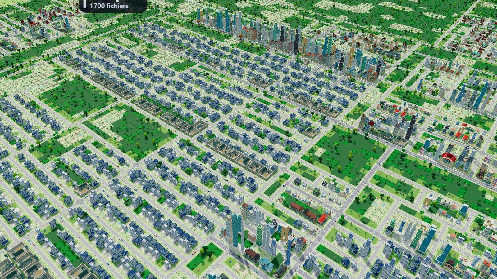
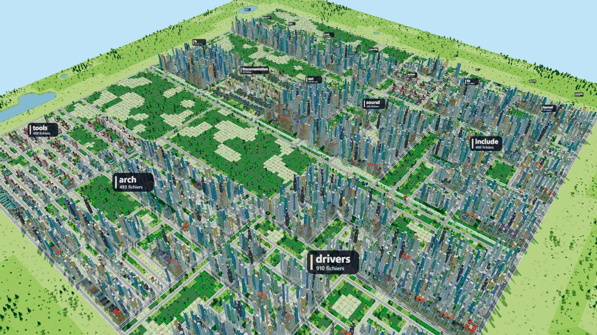
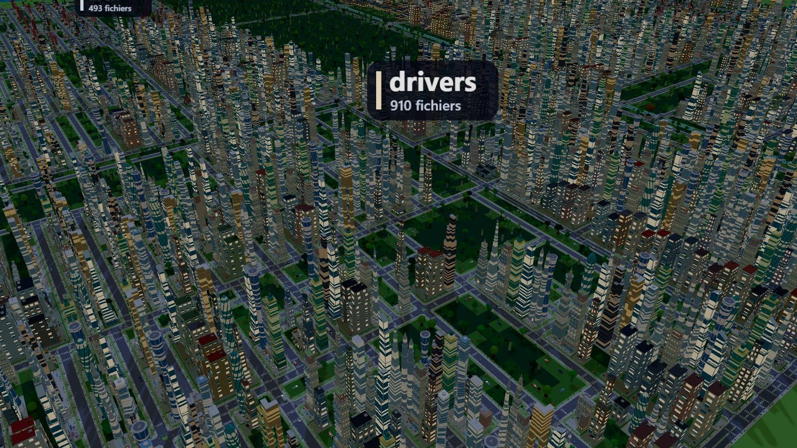

<div align="center">

[Français](README.md) · [English](README.en.md) · **Español** · [Deutsch](README.de.md)

# 🏙️ BITROPOLIS

### Tu código se convierte en una ciudad que crece con él.

Cada carpeta es un barrio, cada archivo un edificio, cada dependencia una calle.
Cuanto más crece un archivo, más sube de nivel su edificio.

[](https://kila86508.github.io/Bitropolis/dist/bitropolis.html)
[](#-100--local-de-verdad)
[](https://nodejs.org)
[](https://www.npmjs.com/package/bitropolis)
[](LICENSE)


</div>

## ✨ En resumen

- 🏗️ **Una ciudad viva**: edificios low poly con 8 etapas, calles de 4 tamaños, un río con puentes, rotondas, tráfico con semáforos y atascos, día y noche.
- 🐧 **Incluso para un proyecto enorme**: el núcleo de Linux (97 000 archivos) se convierte en una ciudad fluida, construida en segundos.
- 📈 **Evoluciona con tu código**: cada vez que la regeneras, los archivos que crecieron hacen subir su edificio ante tus ojos.
- 🌄 **Un mapa único por proyecto**: campo procedural (colinas, lagos, bosques) sobre una base de diorama.
- 🔒 **100 % local**: un único archivo HTML, ninguna petición de red, ni una línea de tu código copiada.
- 🩺 **Una herramienta de verdad**: el modo Salud detecta archivos enormes, ciclos de imports, código muerto y TODO acumulados.
- 🎬 **Para compartir**: exporta tu ciudad como imagen, GIF animado o vídeo timelapse de su construcción.

## 🗺️ El principio

| En tu código | En la ciudad |
|---|---|
| 📁 Carpeta | 🏘️ Barrio, con su cartel |
| 📄 Archivo | 🏢 Edificio, con la fachada hacia la calle |
| 📏 Tamaño y función del archivo | 🏗️ Etapa del edificio: de N1 (cabaña) a N8 (torre) |
| 🔗 Imports entre archivos | 🛣️ Calles y tráfico: las avenidas más transitadas suben de categoría |
| 🚀 Punto de entrada (`main`, `index`, `app`…) | 🏛️ Ayuntamiento, uno solo |

### 🏛️ Un tipo de edificio por función

| Edificio | Archivos |
|---|---|
| 🏛️ **Ayuntamiento** | El punto de entrada principal |
| 🏢 **Viviendas, oficinas** | El código fuente principal |
| 🛍️ **Comercios, teatros** | La interfaz: componentes, vistas, páginas, CSS |
| 🏦 **Oficinas, centros de investigación** | Los datos: modelos, esquemas, stores, tipos |
| 🚓 **Comisaría** | Los tests y la seguridad |
| 🚒 **Bomberos, estación de autobuses** | CI/CD, Docker, scripts, despliegue |
| 🏥 **Clínica → hospital** | Errores, logs, monitorización |
| 📚 **Biblioteca, escuela, torre del reloj** | La documentación |
| 🏭 **Taller → fábrica → complejo industrial** | La configuración y las herramientas |
| ⚡ **Eólica → solar → carbón → nuclear** | Las dependencias (`package.json`, `Cargo.toml`…) |
| 💧 **Depósito de agua → depuradora** | Datos en bruto: SQL, CSV, migraciones |
| 🌳 **Parque, fuente, memorial** | Los assets: imágenes, sonidos, fuentes |

## 🏙️ Ciudades famosas

Algunos grandes proyectos open source, tal como los ve Bitropolis.

<table>
  <tr>
    <td width="50%"><br><sub><b>⚛️ React</b>: una ciudad de comisarías. Sus miles de tests se convierten en barrios enteros.</sub></td>
    <td width="50%"><br><sub><b>🌃 VS Code</b>, con el tema Cyberpunk: 21 600 archivos, 22 660 enlaces.</sub></td>
  </tr>
  <tr>
    <td width="50%"><br><sub><b>🐍 CPython</b>, de noche: <code>Modules</code>, <code>Objects</code>, <code>Lib</code>…</sub></td>
    <td width="50%"><br><sub><b>🦀 Rust</b>: el barrio <code>compiler</code> es un auténtico centro financiero.</sub></td>
  </tr>
</table>

Para verlas en tu equipo (clon ligero de la última versión y luego la ciudad):

```bash
git clone --depth 1 https://github.com/facebook/react.git
npx bitropolis react

git clone --depth 1 https://github.com/microsoft/vscode.git
npx bitropolis vscode

git clone --depth 1 https://github.com/python/cpython.git
npx bitropolis cpython

git clone --depth 1 https://github.com/rust-lang/rust.git
npx bitropolis rust

git clone --depth 1 https://github.com/torvalds/linux.git
npx bitropolis linux
```

> Cada ciudad se construye en 1 a 12 segundos y conserva 4000 edificios representativos, sea cual sea el número de archivos.

## 🏗️ Una ciudad que crece con tu código

- **Etapas N1 → N8.** Cada archivo sigue una cadena de edificios, que puede cambiar de familia por el camino (*clínica → hospital*, *aerogenerador → central nuclear*…). La etapa es **absoluta**: 1 línea = 1 punto, +15 por cada archivo que lo importa, más la complejidad. Un archivo nunca encoge porque otros crezcan. La ficha del edificio muestra el progreso hacia la siguiente etapa.
- **Evolución.** En cada generación, Bitropolis compara con la anterior: la CLI relee el antiguo `index.html` y el navegador recuerda tu última visita. Los edificios que crecieron y los archivos nuevos surgen del suelo, con una etiqueta como «Résidence N3 → N4».
- **Calles N1 → N8.** Cada dependencia entre dos barrios recorre el camino más corto por la red de calles. Las avenidas más cargadas se convierten en bulevares iluminados, y en sus plazas aparecen monumentos.
- **Variedad.** Varias familias y variantes de color por tipo de archivo, paletas recoloreadas, edificios en espejo, jardines, plazoletas y aparcamientos: no hay dos proyectos iguales.
- **Vida.** Un río atraviesa la ciudad y cada calle lo cruza por un puente. Semáforos, prioridad a la derecha, rotondas, pasos elevados en los grandes cruces; aerogeneradores que giran, chimeneas que humean, fuentes que brotan.

## 🚀 Uso

### Opción 1: sin instalar nada

Abre la **[demo en línea](https://kila86508.github.io/Bitropolis/dist/bitropolis.html)**, o [`dist/bitropolis.html`](dist/bitropolis.html) en local (doble clic), y luego **arrastra tu carpeta** o haz clic en «📁 Abrir una carpeta de código». Todo ocurre en tu navegador: no se envía nada. La demo en línea es a propósito un proyecto pequeño, para abrirse en un instante; tu proyecto puede ser enorme (una barra de progreso sigue la importación).

### Opción 2: línea de comandos (Node.js ≥ 18)

```bash
npx bitropolis ~/code/mi-proyecto
```

O desde el código fuente:

```bash
git clone https://github.com/Kila86508/Bitropolis.git
cd Bitropolis
npm install
node bin/bitropolis.js ~/code/mi-proyecto
```

La ciudad se genera en `bitropolis-city/index.html` y se abre sola. Vuelve a ejecutar el mismo comando después de programar: los edificios que crecieron cobran vida.

```text
bitropolis [carpeta] [opciones]
  -o, --out <archivo>   Archivo HTML que crear (por defecto: ./bitropolis-city/index.html)
  -n, --name <nombre>   Nombre de la ciudad
      --json            Exporta también el análisis en bruto (.city.json)
      --no-open         No abrir el navegador
  -l, --lang <xx>       Idioma: en, fr, de, it, es, zh, ru
```

El archivo generado es **autónomo**: envíaselo a un amigo, se abre sin servidor ni Internet.

### 🎮 Controles

| Acción | Ratón / teclado |
|---|---|
| Girar | Arrastrar (clic izquierdo) |
| Desplazarse | Clic derecho, o `WASD` / `ZQSD` / flechas |
| Zoom | Rueda, `+` / `-` |
| Información de un edificio | Clic |
| Acercarse | Doble clic |
| Buscar un archivo | `/` |
| Deseleccionar | `Esc` |

Barra de herramientas: 🌙 día / noche · 🔗 todas las dependencias · 🚗 tráfico · 🏷️ barrios · 🎯 recentrar · 🎲 nuevo campo · 🩺 salud del código · 📸 exportar (imagen, GIF, vídeo) · tema · idioma.

> 🌐 La interfaz y la CLI hablan **español, inglés, francés, alemán, italiano, chino y ruso**: se elige automáticamente el idioma del navegador (o del sistema), y el menú de idioma de la barra de herramientas permite cambiarlo.

## 🐧 ¿Y con un proyecto enorme? El núcleo de Linux



<table>
  <tr>
    <td width="50%"><br><sub><b>🏙️ En el centro</b>: los archivos más importantes y más importados se convierten en rascacielos.</sub></td>
    <td width="50%"><br><sub><b>🌃 De noche</b>: miles de torres, iluminadas planta por planta.</sub></td>
  </tr>
</table>

El núcleo de Linux son **97 000 archivos**. Bitropolis los recorre todos, se queda con **4000 representativos** (cada carpeta grande tiene su parte: `drivers`, `arch`, `kernel`, `mm`, `net`…), enlaza los `#include` (**casi 5900 enlaces**) y construye la ciudad **en 7 segundos**. En pantalla solo se dibujan los edificios visibles, los lejanos en versión simplificada: la ciudad sigue siendo fluida.

Para construirla tú mismo:

```bash
git clone --depth 1 https://github.com/torvalds/linux.git
npx bitropolis linux
```

## 🩺 Salud del código


El botón **🩺 Salud** muestra sobre los edificios lo que merece un vistazo y abre un informe donde cada archivo es clicable:

| Icono | Problema | Regla |
|---|---|---|
| 🔥 | Archivo enorme | 1000 líneas de código o más |
| 🔄 | Dependencia circular | el archivo forma parte de un ciclo de imports (arcos rojos en la ciudad) |
| 🌀 | Muy complejo | 150 ramificaciones o más (`if`, `for`, `&&`…) |
| 🚧 | TODO / FIXME acumulados | 5 o más |
| 👻 | Nunca importado | posible código muerto (salvo puntos de entrada, tests y scripts) |

La ficha de cada edificio también enumera sus alertas. En VS Code, por ejemplo, Bitropolis encuentra 63 ciclos de imports, uno de ellos de 16 archivos.

## 🎬 Exporta tu ciudad

El botón **📸** ofrece tres exportaciones, todas calculadas en tu navegador:

- 🖼️ **Imagen PNG** de la vista actual;
- 🎞️ **GIF animado**: una vuelta completa a la ciudad (512 × 288, en bucle);
- 🎬 **Vídeo timelapse** (MP4 o WebM según el navegador): los edificios surgen uno a uno, del ayuntamiento hacia la periferia, mientras la cámara gira.

## 🔒 100 % local, de verdad

- Ninguna petición de red: three.js y los modelos 3D van **integrados** en el HTML. Sin CDN, sin analítica.
- El archivo generado **no contiene tu código**: solo las rutas de los archivos y cifras (líneas, enlaces, etapas).
- Se ignoran `node_modules`, `.git`, `dist`, `build`, las carpetas ocultas y todo lo que indique tu `.gitignore`.

## 🧠 Lenguajes compatibles

Los enlaces entre archivos se detectan en **JavaScript / TypeScript** (ESM, CommonJS, alias `@/`), **Python**, **Go**, **Rust**, **Java / Kotlin / Scala**, **C / C++**, **C#**, **PHP**, **Ruby**, **Dart**, **Lua**, **CSS / SCSS / Less**, **HTML** y **Vue / Svelte / Astro**. Todos los demás archivos también se convierten en edificios.

## 🎨 Temas

| Tema | Estado |
|---|---|
| 🏙️ Ciudad 3D (cuadrícula, edificios que crecen, tráfico) | ✅ por defecto |
| 🔺 Low poly (edificios procedurales) | ✅ disponible |
| 🌃 Cyberpunk (neones, siempre de noche) | ✅ disponible |
| 🏰 Medieval · 👾 Pixel art · ⛩️ Japón | 🔜 próximamente |

<p align="center"><br><sub>🌃 El tema Cyberpunk: la misma ciudad, en neón, de noche.</sub></p>


Un tema no toca ni el análisis ni el plano de la ciudad: solo describe el aspecto de los edificios. Consulta [`docs/THEMES.md`](docs/THEMES.md) para crear uno.

## 🗂️ Arquitectura

```text
bin/bitropolis.js          CLI: analiza una carpeta → HTML autónomo
src/core/analyze.js        métricas, imports, importancia, tipo de edificio
src/core/catalog.js        cadenas de edificios, etapas N1→N8, evolución entre dos análisis
src/core/grid.js           urbanismo en cuadrícula: manzanas, calles por piezas, tráfico, mobiliario
src/core/layout.js         urbanismo del tema low poly
src/core/terrain.js        campo procedural: relieve, agua, vegetación
src/core/obf.js            cifrado de los modelos integrados
src/viewer/render.js       motor 3D (three.js), noche, animaciones, evolución
src/viewer/traffic.js      tráfico: carriles, distancias, semáforos, prioridad a la derecha
src/viewer/citypack.js     renderizado de la ciudad (InstancedMesh, paletas, luces)
src/viewer/landscape.js    renderizado del campo y de la base del diorama
src/viewer/ui.js           interfaz, búsqueda, arrastrar y soltar
src/viewer/export.js       exportación GIF (codificador propio) y vídeo timelapse
scripts/assets.js          convierte los modelos (.glb, .obj) en datos compactos cifrados
scripts/build.js           genera dist/bitropolis.html
```

El núcleo (`src/core`) no tiene dependencias y funciona tanto en Node como en el navegador.

```bash
npm test         # tests (urbanismo, crecimiento, tráfico…)
npm run build    # regenera dist/bitropolis.html
```

> 🔐 Los modelos 3D originales no se publican: solo su versión cifrada va integrada en `dist/bitropolis.html`, y solo se descifra en memoria. Si faltan los modelos, `npm run build` reutiliza el paquete cifrado que ya está en `dist/`, así que cualquiera puede compilar Bitropolis y crear su ciudad.

## 🛣️ Hoja de ruta

- [x] Ciudad en cuadrícula con edificios que crecen y calles por niveles
- [x] Tráfico, semáforos, prioridad a la derecha
- [x] Evolución animada entre dos generaciones
- [x] Río, puentes, pasos elevados y rotondas
- [x] Proyectos enormes: selección representativa, niveles de detalle
- [x] Salud del código: archivos enormes, ciclos de imports, código muerto
- [x] Exportación en imagen, GIF animado y vídeo timelapse
- [ ] Historial de Git: ver cómo se construye la ciudad commit a commit
- [ ] Modo «paseo» en primera persona
- [ ] Clima según el estado del proyecto (TODO, tests que fallan…)
- [x] Tema cyberpunk
- [ ] Temas medieval y pixel art

## 📄 Licencia

El **código** se publica bajo licencia [MIT](LICENSE): haz lo que quieras con él, ¡y enséñanos tu ciudad!
Los **modelos 3D** integrados siguen siendo propiedad de su autor y no están cubiertos por esta licencia.
