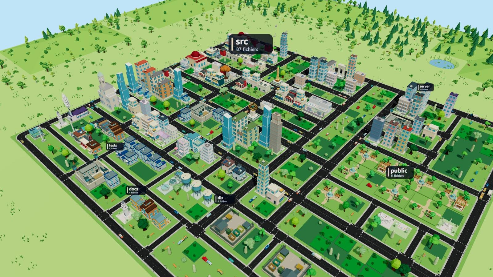
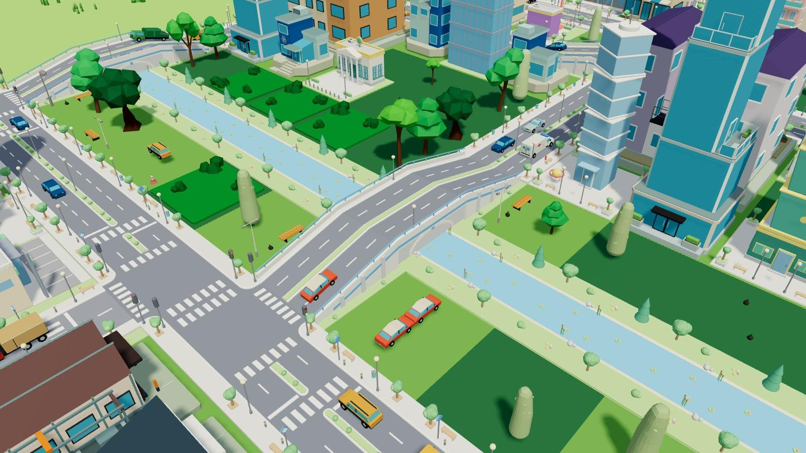
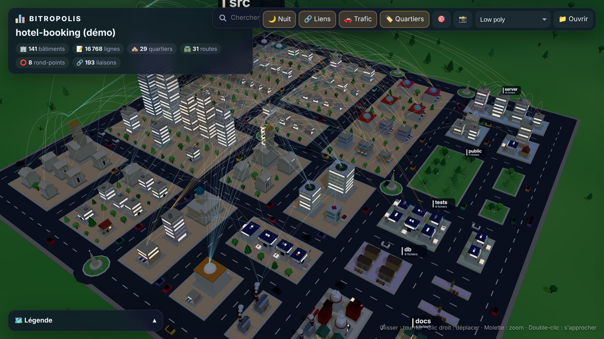
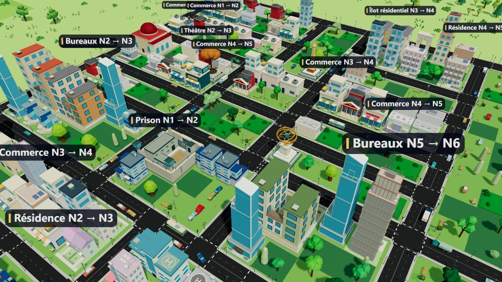
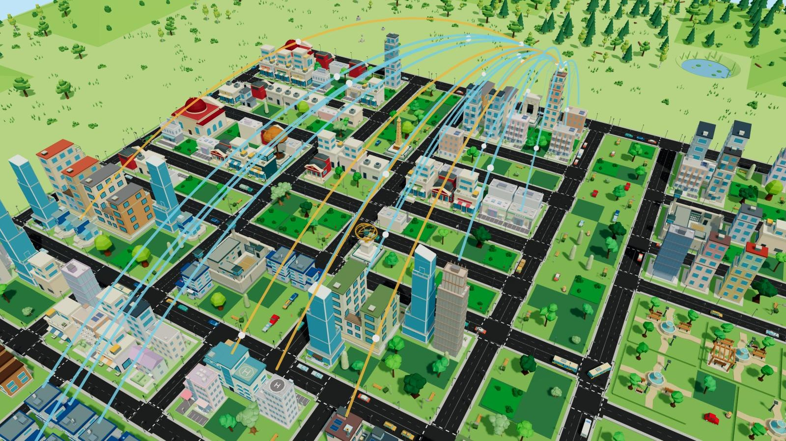
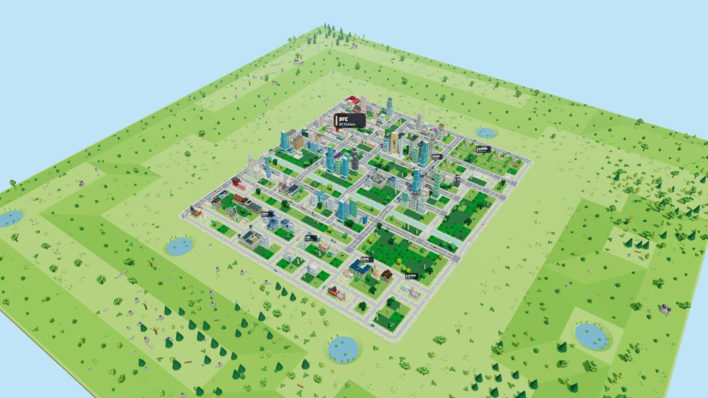
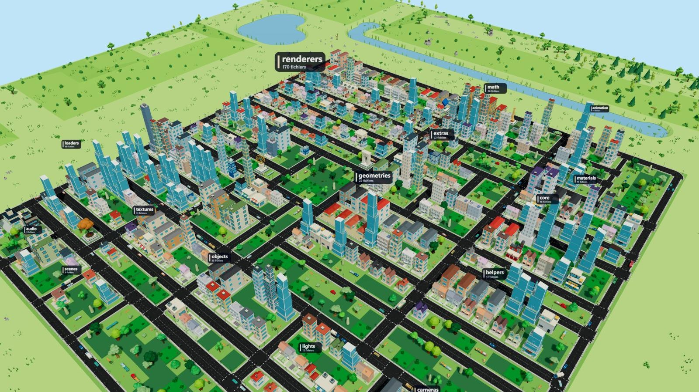
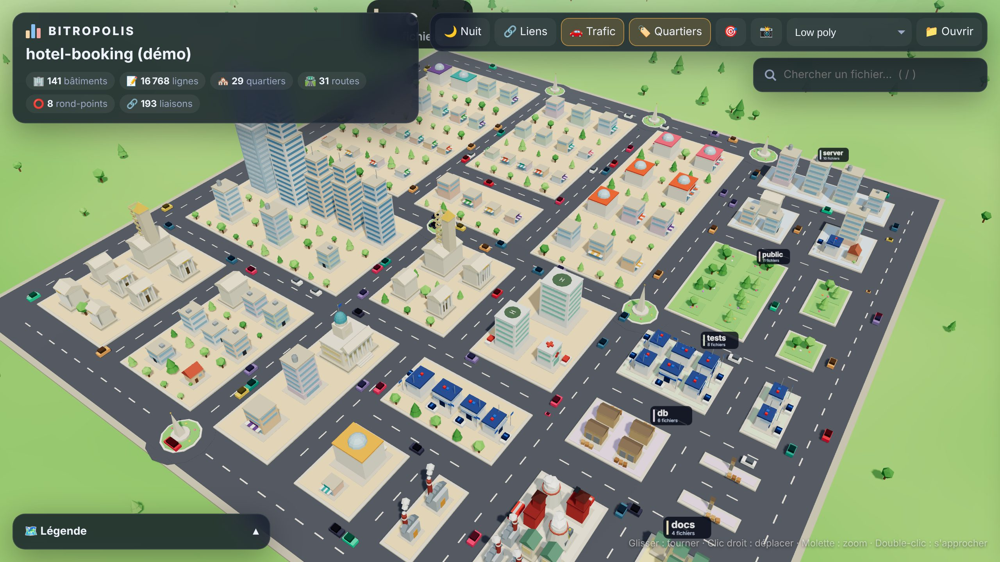

<div align="center">

[Français](README.md) · [English](README.en.md) · **Español** · [Deutsch](README.de.md)

# 🏙️ BITROPOLIS

### Tu código se convierte en una ciudad que crece con él.

Cada carpeta es un barrio, cada archivo un edificio, cada dependencia una calle.
Cuanto más crece un archivo, más sube de nivel su edificio.

[](https://kila86508.github.io/Bitropolis/dist/bitropolis.html)
[](#-100--local-de-verdad)
[](https://nodejs.org)
[](https://www.npmjs.com/package/bitropolis)
[](LICENSE)



</div>

## ✨ En resumen

- 🏗️ **Una ciudad viva**: edificios low poly con 8 etapas, calles con 8 niveles, tráfico con semáforos y atascos, día y noche.
- 📈 **Evoluciona con tu código**: cada vez que la regeneras, los archivos que crecieron hacen subir su edificio ante tus ojos.
- 🌄 **Un mapa único por proyecto**: campo procedural (colinas, lagos, bosques) sobre una base de diorama.
- 🔒 **100 % local**: un único archivo HTML, ninguna petición de red, ni una línea de tu código copiada.

## 🗺️ El principio

| En tu código | En la ciudad |
|---|---|
| 📁 Carpeta | 🏘️ Barrio, con su cartel |
| 📄 Archivo | 🏢 Edificio, con la fachada hacia la calle |
| 📏 Tamaño y función del archivo | 🏗️ Etapa del edificio: de N1 (cabaña) a N8 (torre) |
| 🔗 Imports entre archivos | 🛣️ Calles y tráfico: las avenidas más transitadas suben de categoría |
| 🚀 Punto de entrada (`main`, `index`, `app`…) | 🏛️ Ayuntamiento, uno solo |

### 🏛️ Un tipo de edificio por función

| Edificio | Archivos |
|---|---|
| 🏛️ **Ayuntamiento** | El punto de entrada principal |
| 🏢 **Viviendas, oficinas** | El código fuente principal |
| 🛍️ **Comercios, teatros** | La interfaz: componentes, vistas, páginas, CSS |
| 🏦 **Oficinas, centros de investigación** | Los datos: modelos, esquemas, stores, tipos |
| 🚓 **Comisaría** | Los tests y la seguridad |
| 🚒 **Bomberos, estación de autobuses** | CI/CD, Docker, scripts, despliegue |
| 🏥 **Clínica → hospital** | Errores, logs, monitorización |
| 📚 **Biblioteca, escuela, torre del reloj** | La documentación |
| 🏭 **Taller → fábrica → complejo industrial** | La configuración y las herramientas |
| ⚡ **Eólica → solar → carbón → nuclear** | Las dependencias (`package.json`, `Cargo.toml`…) |
| 💧 **Depósito de agua → depuradora** | Datos en bruto: SQL, CSV, migraciones |
| 🌳 **Parque, fuente, memorial** | Los assets: imágenes, sonidos, fuentes |

## 📸 Galería

<table>
  <tr>
    <td width="50%"><br><sub><b>🚦 Tráfico</b>: los coches circulan por la derecha, guardan la distancia y paran en rojo.</sub></td>
    <td width="50%"><br><sub><b>🌙 Noche</b>: las farolas se encienden y las ventanas se encienden y apagan planta por planta.</sub></td>
  </tr>
  <tr>
    <td width="50%"><br><sub><b>📈 Evolución</b>: lo que creció desde la última generación surge del suelo con su nueva etapa.</sub></td>
    <td width="50%"><br><sub><b>🔗 Dependencias</b>: haz clic en un edificio para ver lo que usa (naranja) y quién lo usa (azul).</sub></td>
  </tr>
</table>


<p align="center"><sub><b>🌄 El diorama</b>: cada proyecto tiene su propio campo, generado a partir de su nombre. El botón 🎲 genera otro.</sub></p>

## 🏗️ Una ciudad que crece con tu código

- **Etapas N1 → N8.** Cada archivo sigue una cadena de edificios, que puede cambiar de familia por el camino (*clínica → hospital*, *aerogenerador → central nuclear*…). La etapa es **absoluta**: 1 línea = 1 punto, +15 por cada archivo que lo importa, más la complejidad. Un archivo nunca encoge porque otros crezcan. La ficha del edificio muestra el progreso hacia la siguiente etapa.
- **Evolución.** En cada generación, Bitropolis compara con la anterior: la CLI relee el antiguo `index.html` y el navegador recuerda tu última visita. Los edificios que crecieron y los archivos nuevos surgen del suelo, con una etiqueta como «Résidence N3 → N4».
- **Calles N1 → N8.** Cada dependencia entre dos barrios recorre el camino más corto por la red de calles. Las avenidas más cargadas se convierten en bulevares iluminados, y en sus plazas aparecen monumentos.
- **Variedad.** Varias familias y variantes de color por tipo de archivo, paletas recoloreadas, edificios en espejo, jardines, plazoletas y aparcamientos: no hay dos proyectos iguales.
- **Vida.** Semáforos y prioridad a la derecha, aerogeneradores que giran, chimeneas que humean, fuentes que brotan.

## 🚀 Uso

### Opción 1: sin instalar nada

Abre la **[demo en línea](https://kila86508.github.io/Bitropolis/dist/bitropolis.html)**, o [`dist/bitropolis.html`](dist/bitropolis.html) en local (doble clic), y luego **arrastra tu carpeta** o haz clic en «📁 Abrir una carpeta de código». Todo ocurre en tu navegador: no se envía nada.

### Opción 2: línea de comandos (Node.js ≥ 18)

```bash
npx bitropolis ~/code/mi-proyecto
```

O desde el código fuente:

```bash
git clone https://github.com/Kila86508/Bitropolis.git
cd Bitropolis
npm install
node bin/bitropolis.js ~/code/mi-proyecto
```

La ciudad se genera en `bitropolis-city/index.html` y se abre sola. Vuelve a ejecutar el mismo comando después de programar: los edificios que crecieron cobran vida.

```text
bitropolis [carpeta] [opciones]
  -o, --out <archivo>   Archivo HTML que crear (por defecto: ./bitropolis-city/index.html)
  -n, --name <nombre>   Nombre de la ciudad
      --json            Exporta también el análisis en bruto (.city.json)
      --no-open         No abrir el navegador
  -l, --lang <xx>       Idioma: en, fr, de, it, es, zh, ru
```

El archivo generado es **autónomo**: envíaselo a un amigo, se abre sin servidor ni Internet.

### 🎮 Controles

| Acción | Ratón / teclado |
|---|---|
| Girar | Arrastrar (clic izquierdo) |
| Desplazarse | Clic derecho, o `WASD` / `ZQSD` / flechas |
| Zoom | Rueda, `+` / `-` |
| Información de un edificio | Clic |
| Acercarse | Doble clic |
| Buscar un archivo | `/` |
| Deseleccionar | `Esc` |

Barra de herramientas: 🌙 día / noche · 🔗 todas las dependencias · 🚗 tráfico · 🏷️ barrios · 🎯 recentrar · 🎲 nuevo campo · 📸 captura · tema · idioma.

> 🌐 La interfaz y la CLI hablan **español, inglés, francés, alemán, italiano, chino y ruso**: se elige automáticamente el idioma del navegador (o del sistema), y el menú de idioma de la barra de herramientas permite cambiarlo.

## 🏙️ ¿Y con un proyecto realmente grande?


<p align="center"><sub>Las fuentes de three.js: 374 edificios, construidos en menos de un segundo.</sub></p>

## 🔒 100 % local, de verdad

- Ninguna petición de red: three.js y los modelos 3D van **integrados** en el HTML. Sin CDN, sin analítica.
- El archivo generado **no contiene tu código**: solo las rutas de los archivos y cifras (líneas, enlaces, etapas).
- Se ignoran `node_modules`, `.git`, `dist`, `build`, las carpetas ocultas y todo lo que indique tu `.gitignore`.

## 🧠 Lenguajes compatibles

Los enlaces entre archivos se detectan en **JavaScript / TypeScript** (ESM, CommonJS, alias `@/`), **Python**, **Go**, **Rust**, **Java / Kotlin / Scala**, **C / C++**, **C#**, **PHP**, **Ruby**, **Dart**, **Lua**, **CSS / SCSS / Less**, **HTML** y **Vue / Svelte / Astro**. Todos los demás archivos también se convierten en edificios.

## 🎨 Temas

| Tema | Estado |
|---|---|
| 🏙️ Ciudad 3D (cuadrícula, edificios que crecen, tráfico) | ✅ por defecto |
| 🔺 Low poly (edificios procedurales) | ✅ disponible |
| 🏰 Medieval · 👾 Pixel art · 🌃 Cyberpunk · ⛩️ Japón | 🔜 próximamente |

<p align="center"><br><sub>El tema low poly.</sub></p>

Un tema no toca ni el análisis ni el plano de la ciudad: solo describe el aspecto de los edificios. Consulta [`docs/THEMES.md`](docs/THEMES.md) para crear uno.

## 🗂️ Arquitectura

```text
bin/bitropolis.js          CLI: analiza una carpeta → HTML autónomo
src/core/analyze.js        métricas, imports, importancia, tipo de edificio
src/core/catalog.js        cadenas de edificios, etapas N1→N8, evolución entre dos análisis
src/core/grid.js           urbanismo en cuadrícula: manzanas, calles por piezas, tráfico, mobiliario
src/core/layout.js         urbanismo del tema low poly
src/core/terrain.js        campo procedural: relieve, agua, vegetación
src/core/obf.js            cifrado de los modelos integrados
src/viewer/render.js       motor 3D (three.js), noche, animaciones, evolución
src/viewer/traffic.js      tráfico: carriles, distancias, semáforos, prioridad a la derecha
src/viewer/citypack.js     renderizado de la ciudad (InstancedMesh, paletas, luces)
src/viewer/landscape.js    renderizado del campo y de la base del diorama
src/viewer/ui.js           interfaz, búsqueda, arrastrar y soltar
scripts/assets.js          convierte los modelos (.glb, .obj) en datos compactos cifrados
scripts/build.js           genera dist/bitropolis.html
```

El núcleo (`src/core`) no tiene dependencias y funciona tanto en Node como en el navegador.

```bash
npm test         # tests (urbanismo, crecimiento, tráfico…)
npm run build    # regenera dist/bitropolis.html
```

> 🔐 Los modelos 3D originales no se publican: solo su versión cifrada va integrada en `dist/bitropolis.html`, y solo se descifra en memoria. Si faltan los modelos, `npm run build` reutiliza el paquete cifrado que ya está en `dist/`, así que cualquiera puede compilar Bitropolis y crear su ciudad.

## 🛣️ Hoja de ruta

- [x] Ciudad en cuadrícula con edificios que crecen y calles por niveles
- [x] Tráfico, semáforos, prioridad a la derecha
- [x] Evolución animada entre dos generaciones
- [ ] Historial de Git: ver cómo se construye la ciudad commit a commit
- [ ] Modo «paseo» en primera persona
- [ ] Clima según el estado del proyecto (TODO, tests que fallan…)
- [ ] Temas medieval, pixel art y cyberpunk

## 📄 Licencia

El **código** se publica bajo licencia [MIT](LICENSE): haz lo que quieras con él, ¡y enséñanos tu ciudad!
Los **modelos 3D** integrados siguen siendo propiedad de su autor y no están cubiertos por esta licencia.
