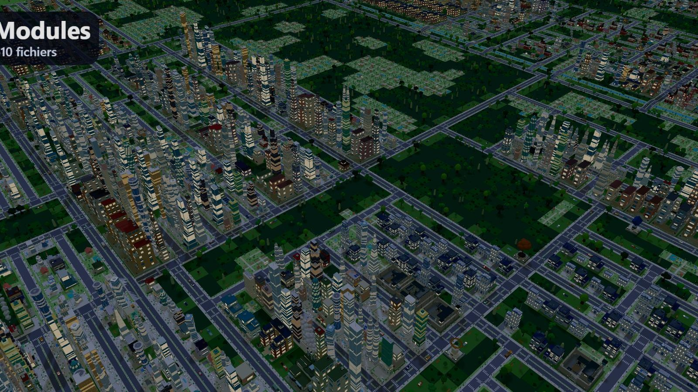
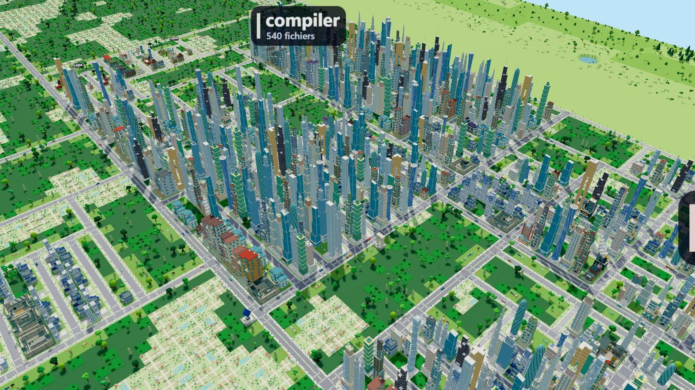

<div align="center">

**Français** · [English](README.en.md) · [Español](README.es.md) · [Deutsch](README.de.md)

# 🏙️ BITROPOLIS

### Ton code devient une ville qui grandit avec lui.

Chaque dossier est un quartier, chaque fichier un bâtiment, chaque dépendance une route.
Plus un fichier grossit, plus son bâtiment monte en gamme.

[](https://kila86508.github.io/Bitropolis/dist/bitropolis.html)
[](#-100--local-vraiment)
[](https://nodejs.org)
[](https://www.npmjs.com/package/bitropolis)
[](LICENSE)


</div>

## ✨ En bref

- 🏗️ **Une ville vivante** : bâtiments low poly à 8 stades, routes à 4 gabarits, rivière et ponts, ronds-points, circulation avec feux et bouchons, jour et nuit.
- 🐧 **Même pour un projet énorme** : le noyau Linux (97 000 fichiers) devient une ville fluide, construite en quelques secondes.
- 📈 **Elle évolue avec ton code** : à chaque nouvelle génération, les fichiers qui ont grandi font monter leur bâtiment, sous tes yeux.
- 🌄 **Une carte unique par projet** : campagne procédurale (collines, lacs, forêts) posée sur un socle de diorama.
- 🔒 **100 % local** : un seul fichier HTML, aucune requête réseau, pas une ligne de ton code copiée.
- 🩺 **Un vrai outil** : le mode Santé repère les fichiers géants, les boucles d'imports, le code mort, les TODO accumulés.
- 🎬 **À partager** : exporte ta ville en image, en GIF animé ou en vidéo timelapse de sa construction.

## 🗺️ Le principe

| Dans ton code | Dans la ville |
|---|---|
| 📁 Dossier | 🏘️ Quartier, avec son panneau |
| 📄 Fichier | 🏢 Bâtiment, façade tournée vers la rue |
| 📏 Taille et usage du fichier | 🏗️ Stade du bâtiment : de N1 (cabane) à N8 (tour) |
| 🔗 Imports entre fichiers | 🛣️ Routes et trafic : les avenues les plus empruntées montent en gamme |
| 🚀 Point d'entrée (`main`, `index`, `app`…) | 🏛️ Hôtel de ville, unique |

### 🏛️ Un type de bâtiment par rôle

| Bâtiment | Fichiers concernés |
|---|---|
| 🏛️ **Hôtel de ville** | Le point d'entrée principal |
| 🏢 **Résidences, bureaux** | Le code source « métier » |
| 🛍️ **Commerces, théâtres** | L'interface : composants, vues, pages, CSS |
| 🏦 **Bureaux, centres de recherche** | Les données : modèles, schémas, store, types |
| 🚓 **Commissariat** | Les tests et la sécurité |
| 🚒 **Caserne, gare routière** | CI/CD, Docker, scripts, déploiement |
| 🏥 **Clinique → hôpital** | Erreurs, logs, monitoring |
| 📚 **Bibliothèque, école, tour de l'horloge** | La documentation |
| 🏭 **Atelier → usine → complexe industriel** | La configuration et l'outillage |
| ⚡ **Éolienne → solaire → charbon → nucléaire** | Les dépendances (`package.json`, `Cargo.toml`…) |
| 💧 **Château d'eau → station d'épuration** | Données brutes : SQL, CSV, migrations |
| 🌳 **Parc, fontaine, mémorial** | Les assets : images, sons, polices |

## 🏙️ Villes célèbres

Quelques grands projets open source, tels que Bitropolis les voit.

<table>
  <tr>
    <td width="50%"><br><sub><b>⚛️ React</b> : une ville de commissariats. Ses milliers de tests deviennent des quartiers entiers.</sub></td>
    <td width="50%"><br><sub><b>🌃 VS Code</b>, en thème Cyberpunk : 21 600 fichiers, 22 660 liaisons.</sub></td>
  </tr>
  <tr>
    <td width="50%"><br><sub><b>🐍 CPython</b>, de nuit : <code>Modules</code>, <code>Objects</code>, <code>Lib</code>…</sub></td>
    <td width="50%"><br><sub><b>🦀 Rust</b> : le quartier <code>compiler</code> forme un vrai centre d'affaires.</sub></td>
  </tr>
</table>

Pour les voir chez toi (clone léger de la dernière version, puis la ville) :

```bash
git clone --depth 1 https://github.com/facebook/react.git
npx bitropolis react

git clone --depth 1 https://github.com/microsoft/vscode.git
npx bitropolis vscode

git clone --depth 1 https://github.com/python/cpython.git
npx bitropolis cpython

git clone --depth 1 https://github.com/rust-lang/rust.git
npx bitropolis rust

git clone --depth 1 https://github.com/torvalds/linux.git
npx bitropolis linux
```

> Chaque ville se construit en 1 à 12 secondes et garde 4 000 bâtiments représentatifs, quel que soit le nombre de fichiers.

## 🏗️ Une ville qui grandit avec ton code

- **Stades N1 → N8.** Chaque fichier suit une chaîne de bâtiments, qui peut changer de famille en route (*clinique → hôpital*, *éolienne → centrale nucléaire*…). Le stade est **absolu** : 1 ligne = 1 point, +15 par fichier qui l'importe, plus la complexité. Un fichier ne rétrécit donc jamais parce que d'autres grossissent. La fiche du bâtiment affiche la progression vers le stade suivant.
- **Évolution.** À chaque génération, Bitropolis compare avec la précédente : la CLI relit l'ancien `index.html`, le navigateur se souvient de ta dernière visite. Les bâtiments qui ont grandi et les nouveaux fichiers sortent de terre, avec une étiquette « Résidence N3 → N4 ».
- **Routes N1 → N8.** Chaque dépendance entre deux quartiers est acheminée par le plus court chemin routier. Les avenues les plus chargées deviennent des boulevards éclairés, et des monuments s'installent sur leurs places.
- **Variété.** Plusieurs familles et variantes de couleurs par type de fichier, palettes recolorées, bâtiments inversés en miroir, jardins, placettes et parkings : deux projets ne se ressemblent jamais.
- **Vie.** Une rivière traverse la ville : chaque rue la franchit par un pont. Feux tricolores, priorité à droite, ronds-points, passages supérieurs sur les grands carrefours ; éoliennes qui tournent, cheminées qui fument, fontaines qui jaillissent.

## 🚀 Utilisation

### Option 1 : sans rien installer

Ouvre la **[démo en ligne](https://kila86508.github.io/Bitropolis/dist/bitropolis.html)**, ou [`dist/bitropolis.html`](dist/bitropolis.html) en local (double-clic), puis **glisse-dépose ton dossier** ou clique sur « 📁 Ouvrir un dossier de code ». Tout se passe dans ton navigateur : rien n'est envoyé. La démo en ligne est volontairement un petit projet, pour s'ouvrir en un clin d'œil ; ton projet, lui, peut être immense (une barre de progression suit l'import).

### Option 2 : en ligne de commande (Node.js ≥ 18)

```bash
npx bitropolis ~/code/mon-projet
```

Ou depuis les sources :

```bash
git clone https://github.com/Kila86508/Bitropolis.git
cd Bitropolis
npm install
node bin/bitropolis.js ~/code/mon-projet
```

La ville est générée dans `bitropolis-city/index.html` et s'ouvre toute seule. Relance la même commande après avoir codé : les bâtiments qui ont grandi s'animent.

```text
bitropolis [dossier] [options]
  -o, --out <fichier>   Fichier HTML à créer (défaut : ./bitropolis-city/index.html)
  -n, --name <nom>      Nom de la ville
      --json            Exporte aussi l'analyse brute (.city.json)
      --no-open         Ne pas ouvrir le navigateur
  -l, --lang <xx>       Langue : en, fr, de, it, es, zh, ru
```

Le fichier généré est **autonome** : envoie-le à un ami, il s'ouvre sans serveur ni Internet.

### 🎮 Commandes

| Action | Souris / clavier |
|---|---|
| Tourner | Glisser (clic gauche) |
| Se déplacer | Clic droit, ou `ZQSD` / `WASD` / flèches |
| Zoomer | Molette, `+` / `-` |
| Infos d'un bâtiment | Clic |
| S'approcher | Double-clic |
| Chercher un fichier | `/` |
| Désélectionner | `Échap` |

Barre d'outils : 🌙 jour / nuit · 🔗 toutes les liaisons · 🚗 trafic · 🏷️ quartiers · 🎯 recentrer · 🎲 nouvelle campagne · 🩺 santé du code · 📸 export (image, GIF, vidéo) · thème · langue.

> 🌐 L'interface et la CLI parlent **français, anglais, allemand, italien, espagnol, chinois et russe** : la langue du navigateur (ou du système) est choisie automatiquement, et le menu de langue de la barre d'outils permet d'en changer.

## 🐧 Et sur un très gros projet ? Le noyau Linux


<table>
  <tr>
    <td width="50%"><br><sub><b>🏙️ Au cœur de la ville</b> : les fichiers les plus importants et les plus importés deviennent des gratte-ciel.</sub></td>
    <td width="50%"><br><sub><b>🌃 De nuit</b> : des milliers de tours, éclairées étage par étage.</sub></td>
  </tr>
</table>

Le noyau Linux, c'est **97 000 fichiers**. Bitropolis les parcourt tous, en retient **4 000 représentatifs** (chaque grand dossier a sa part : `drivers`, `arch`, `kernel`, `mm`, `net`…), relie les `#include` (**près de 5 900 liaisons**) et bâtit la ville **en 7 secondes**. À l'écran, seuls les bâtiments visibles sont dessinés, les plus lointains en version simplifiée : la ville reste fluide.

Pour la construire toi-même :

```bash
git clone --depth 1 https://github.com/torvalds/linux.git
npx bitropolis linux
```

## 🩺 Santé du code


Le bouton **🩺 Santé** affiche au-dessus des bâtiments ce qui mérite un coup d'œil, et ouvre un rapport où chaque fichier est cliquable :

| Icône | Problème | Règle |
|---|---|---|
| 🔥 | Fichier géant | 1 000 lignes de code ou plus |
| 🔄 | Dépendance circulaire | le fichier fait partie d'une boucle d'imports (arcs rouges dans la ville) |
| 🌀 | Très complexe | 150 branches ou plus (`if`, `for`, `&&`…) |
| 🚧 | TODO / FIXME accumulés | 5 ou plus |
| 👻 | Jamais importé | code peut-être mort (hors points d'entrée, tests, scripts) |

La fiche de chaque bâtiment liste aussi ses alertes. Sur VS Code, Bitropolis trouve par exemple 63 boucles d'imports, dont une de 16 fichiers.

## 🎬 Exporter ta ville

Le bouton **📸** propose trois exports, tous calculés dans ton navigateur :

- 🖼️ **Image PNG** de la vue actuelle ;
- 🎞️ **GIF animé** : un tour complet de la ville (512 × 288, en boucle) ;
- 🎬 **Vidéo timelapse** (MP4 ou WebM selon le navigateur) : les bâtiments sortent de terre un à un, de l'hôtel de ville vers la périphérie, pendant que la caméra tourne.

## 🔒 100 % local, vraiment

- Aucune requête réseau : three.js et les modèles 3D sont **embarqués** dans le HTML. Pas de CDN, pas d'analytics.
- Le fichier généré ne contient **aucune ligne de ton code** : seulement les chemins des fichiers et des chiffres (lignes, liens, stades).
- `node_modules`, `.git`, `dist`, `build`, les dossiers cachés et ce que liste ton `.gitignore` sont ignorés.

## 🧠 Langages compris

Les liens entre fichiers sont détectés pour **JavaScript / TypeScript** (ESM, CommonJS, alias `@/`), **Python**, **Go**, **Rust**, **Java / Kotlin / Scala**, **C / C++**, **C#**, **PHP**, **Ruby**, **Dart**, **Lua**, **CSS / SCSS / Less**, **HTML** et **Vue / Svelte / Astro**. Tous les autres fichiers deviennent quand même des bâtiments.

## 🎨 Thèmes

| Thème | État |
|---|---|
| 🏙️ Ville 3D (grille, bâtiments à stades, circulation) | ✅ par défaut |
| 🔺 Low poly (bâtiments procéduraux) | ✅ disponible |
| 🌃 Cyberpunk (néons, nuit permanente) | ✅ disponible |
| 🏰 Médiéval · 👾 Pixel art · ⛩️ Japon | 🔜 bientôt |

<p align="center"><br><sub>🌃 Le thème Cyberpunk : la même ville, en néons, de nuit.</sub></p>


Un thème ne touche ni à l'analyse ni au plan de la ville : il décrit seulement à quoi ressemblent les bâtiments. Voir [`docs/THEMES.md`](docs/THEMES.md) pour en créer un.

## 🗂️ Architecture

```text
bin/bitropolis.js          CLI : scanne un dossier → HTML autonome
src/core/analyze.js        métriques, imports, importance, type de bâtiment
src/core/catalog.js        chaînes de bâtiments, stades N1→N8, évolution entre deux scans
src/core/grid.js           urbanisme en grille : îlots, routes en tuiles, trafic routé, mobilier
src/core/layout.js         urbanisme du thème low poly
src/core/terrain.js        campagne procédurale : relief, eau, végétation
src/core/obf.js            brouillage des modèles embarqués
src/viewer/render.js       moteur 3D (three.js), nuit, animations, évolution
src/viewer/traffic.js      circulation : voies, distances, feux, priorité à droite
src/viewer/citypack.js     affichage de la ville (InstancedMesh, palettes, lumières)
src/viewer/landscape.js    affichage de la campagne et du socle
src/viewer/ui.js           interface, recherche, glisser-déposer
src/viewer/export.js       export GIF (encodeur maison) et vidéo timelapse
scripts/assets.js          conversion des modèles (.glb, .obj) en données compactes chiffrées
scripts/build.js           construit dist/bitropolis.html
```

Le cœur (`src/core`) n'a aucune dépendance et tourne aussi bien dans Node que dans le navigateur.

```bash
npm test         # tests (urbanisme, croissance, circulation…)
npm run build    # régénère dist/bitropolis.html
```

> 🔐 Les modèles 3D d'origine ne sont pas publiés : seule leur version chiffrée est embarquée dans `dist/bitropolis.html`, et elle n'est déchiffrée qu'en mémoire. Si les modèles sont absents, `npm run build` reprend le pack chiffré déjà présent dans `dist/` : tout le monde peut donc construire Bitropolis et créer sa ville.

## 🛣️ Feuille de route

- [x] Ville en grille avec bâtiments à stades et routes à niveaux
- [x] Circulation, feux tricolores, priorité à droite
- [x] Évolution animée entre deux générations
- [x] Rivière, ponts, passages supérieurs et ronds-points
- [x] Très grands projets : sélection représentative, niveaux de détail
- [x] Santé du code : fichiers géants, boucles d'imports, code mort
- [x] Export image, GIF animé et vidéo timelapse
- [ ] Historique Git : voir la ville se construire commit après commit
- [ ] Mode « visite » à la première personne
- [ ] Météo selon l'état du projet (TODO, tests qui échouent…)
- [x] Thème cyberpunk
- [ ] Thèmes médiéval, pixel art

## 📄 Licence

Le **code** est sous licence [MIT](LICENSE) : fais-en ce que tu veux, et montre-nous ta ville !
Les **modèles 3D** embarqués restent la propriété de leur auteur et ne sont pas couverts par cette licence.
