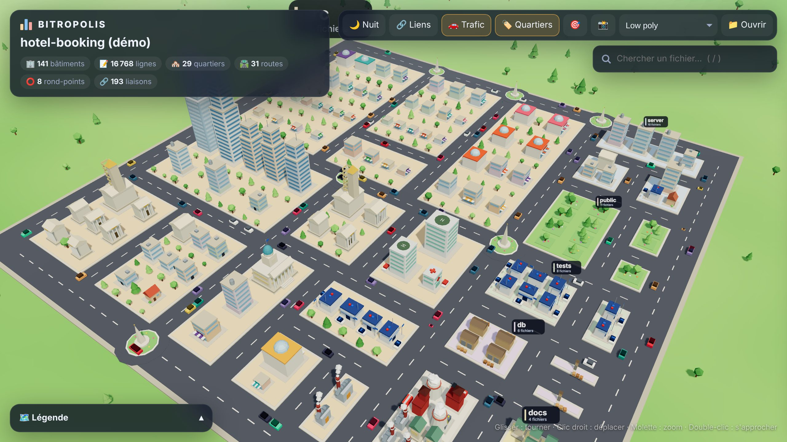
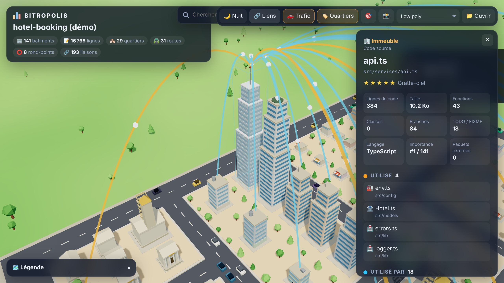
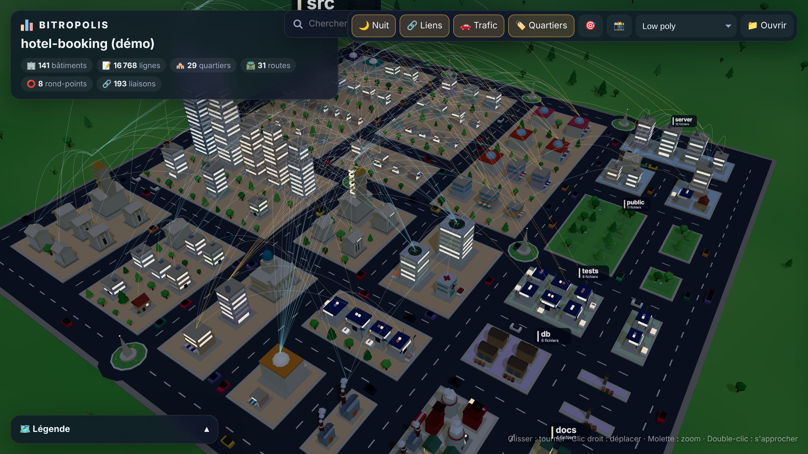
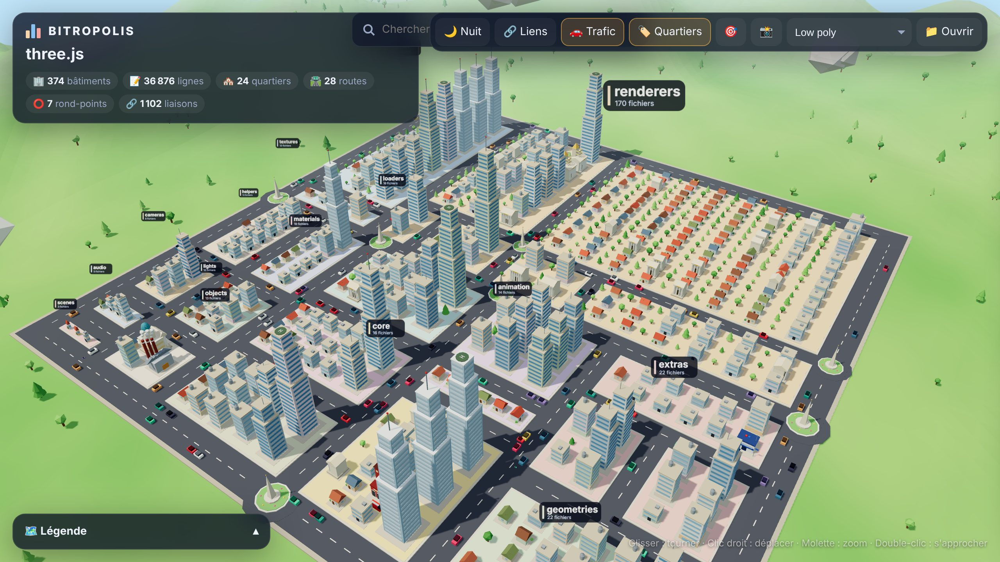

<div align="center">

# 🏙️ BITROPOLIS

**Ton code devient une ville.**
Chaque dossier est un quartier, chaque fichier un bâtiment, chaque dépendance une route.

100 % local · aucune donnée envoyée · un seul fichier HTML



</div>

## ✨ Le principe

Tu donnes ton projet à Bitropolis, il lit le code **sur ta machine** et bâtit une ville 3D :

| Dans ton code | Dans la ville |
|---|---|
| 📁 Dossier | 🏘️ Quartier (avec sa couleur et son panneau) |
| 📄 Fichier | 🏢 Bâtiment sur sa parcelle, façade tournée vers la rue |
| ⭐ Importance du fichier | 🏗️ Niveau du bâtiment : maison → petit immeuble → immeuble → tour → gratte-ciel |
| 🔗 Imports entre fichiers | 🛣️ Routes et voitures : plus il y a de dépendances, plus il y a de trafic |
| 🔀 Gros flux de dépendances entre quartiers | ⭕ Rond-points (avec obélisque quand le trafic est énorme) |
| 🚀 Point d'entrée (`main`, `index`, `app`…) | 🏛️ Hôtel de ville, unique, au cœur de la cité |

### 🏛️ Les bâtiments

| Bâtiment | Fichiers concernés |
|---|---|
| 🏛️ **Hôtel de ville** | Le point d'entrée principal du projet |
| 🏢 **Immeubles** | Le code source « métier » |
| 🛍️ **Commerces** | L'interface : composants, vues, pages, CSS, HTML |
| 🏦 **Banque** | Les données : modèles, schémas, store, types |
| 🚓 **Commissariat** | Les tests et la sécurité (auth, tokens, permissions…) |
| 🚒 **Caserne de pompiers** | CI/CD, Docker, scripts, déploiement |
| 🏥 **Hôpital** | Erreurs, logs, monitoring |
| 📚 **Bibliothèque** | La documentation (Markdown, docs/, LICENSE…) |
| 🏭 **Usine** | La configuration et l'outillage |
| ⚡ **Centrale électrique** | Les dépendances : `package.json`, `Cargo.toml`, `requirements.txt`… |
| 📦 **Entrepôt** | Données brutes : SQL, CSV, migrations, seeds |
| 🌳 **Parc** | Les assets : images, sons, polices, modèles 3D |

Chaque type a **5 niveaux** : un commissariat important gagne des étages et une antenne, une caserne voit sa tour grandir, un hôpital reçoit son héliport, une usine ajoute des cheminées, un parc devient un jardin à fontaine…

**L'importance** d'un fichier est calculée à partir de son nombre de lignes, du nombre de fichiers qui l'importent, de ses propres imports et de sa complexité (branches `if`/`for`/`while`…).

<p align="center">
  
  
</p>

### 🌄 La campagne : une carte unique par projet

Autour de la ville, Bitropolis génère une **campagne procédurale** posée sur un socle de diorama : collines, plateaux à falaises, lacs, rivière, mares, forêts, buissons, rochers et herbes folles. La carte est tirée du **nom du projet** : chaque projet a la sienne, et elle reste la même d'une fois sur l'autre.

- 🎲 **Carte** (barre d'outils) tire une nouvelle campagne pour ce projet ; elle est mémorisée dans ton navigateur. **Maj + clic** revient à la carte d'origine.
- Les modèles viennent du kit `Asset/` (`.glb`). Au build, leurs couleurs sont « cuites » dans les sommets et la géométrie est compressée : tout reste embarqué dans le HTML, sans chargeur ni texture.

### 🏗️ Thème « Ville 3D » : des bâtiments qui grandissent avec ton code

Quand le pack `FULL_VERSION_250_MODELS/` est présent au build, la ville est construite **en grille, façon city-builder**, avec ses modèles : bâtiments, routes, arbres, monuments et véhicules. Sans le pack, Bitropolis garde le thème low poly.

- **Stades N1 → N8** : chaque type de fichier suit une chaîne de bâtiments. Elle peut changer de famille en route, par exemple *éolienne → ferme solaire → centrale à charbon → centrale nucléaire*, ou *clinique → hôpital*, ou *atelier → usine → complexe industriel*. Le stade est **absolu** : il ne dépend que du fichier (1 ligne = 1 point, +15 par fichier qui l'importe, plus la complexité). Un fichier ne rétrécit donc jamais parce que d'autres grossissent. La fiche du bâtiment montre la progression vers le stade suivant.
- **Routes N1 → N8** : chaque dépendance entre deux quartiers est acheminée par le plus court chemin routier. Les avenues les plus empruntées montent en gamme (chemin → boulevard éclairé), et des **monuments** s'installent sur les places qui les bordent.
- **Évolution** : à chaque nouvelle génération, Bitropolis compare avec la précédente. La CLI relit l'ancien `index.html` ; sans elle, le navigateur se souvient de ta dernière visite. Les bâtiments qui ont grandi et les nouveaux fichiers sortent de terre, avec une étiquette « Résidence N3 → N4 ».
- **La nuit**, les fenêtres et les lampadaires du pack s'allument.
- **Animations** : les rotors des éoliennes tournent (balise rouge clignotante), les cheminées des centrales « respirent », les usines et centrales fument, les fontaines des parcs jaillissent et le cube du monument flotte en tournant.

> 🔐 **Modèles protégés** : les fichiers 3D d'origine (`Asset/`, `FULL_VERSION_250_MODELS/`) ne sont pas publiés. Seule leur version chiffrée est embarquée dans `dist/bitropolis.html` et dans les villes générées, et elle n'est déchiffrée qu'en mémoire : pas de fichier à télécharger, pas de nom de modèle lisible, rien d'accessible depuis la console. C'est une dissuasion, pas un verrou : un navigateur doit forcément avoir les modèles pour les afficher. Si les modèles d'origine sont absents, `npm run build` reprend le pack chiffré du `dist/` existant. Tout le monde peut donc construire sa ville avec le pack.

## 🚀 Utilisation

### Option 1 — sans rien installer

Ouvre [`dist/bitropolis.html`](dist/bitropolis.html) dans ton navigateur (double-clic), puis **glisse-dépose ton dossier** ou clique sur « Ouvrir un dossier ». Tout se passe dans ton navigateur, hors-ligne.

### Option 2 — en ligne de commande (Node.js ≥ 18)

```bash
git clone https://github.com/<toi>/bitropolis.git
cd bitropolis
npm install
node bin/bitropolis.js ~/code/mon-projet
```

La ville est générée dans `bitropolis-city/index.html` et s'ouvre toute seule. Options :

```text
bitropolis [dossier] [options]
  -o, --out <fichier>   Fichier HTML à créer (défaut : ./bitropolis-city/index.html)
  -n, --name <nom>      Nom de la ville
      --json            Exporte aussi l'analyse brute (.city.json)
      --no-open         Ne pas ouvrir le navigateur
```

Le fichier généré est **autonome** : tu peux l'envoyer à un ami, il s'ouvre sans serveur ni Internet.

### 🎮 Commandes

| Action | Souris / clavier |
|---|---|
| Tourner | Glisser (clic gauche) |
| Se déplacer | Clic droit, ou `ZQSD` / `WASD` / flèches |
| Zoomer | Molette, `+` / `-` |
| Infos d'un bâtiment | Clic |
| S'approcher | Double-clic |
| Chercher un fichier | `/` |
| Désélectionner | `Échap` |

Barre d'outils : 🌙 jour/nuit · 🔗 toutes les liaisons · 🚗 trafic · 🏷️ noms des quartiers · 🎯 recentrer · 📸 capture PNG.

## 🔒 100 % local, vraiment

- Aucune requête réseau : three.js est **embarqué** dans le HTML, pas de CDN, pas d'analytics.
- Le fichier généré ne contient **aucune ligne de ton code** : seulement les chemins des fichiers et des chiffres (lignes, liens, niveau).
- `node_modules`, `.git`, `dist`, `build`, les dossiers cachés et ce qui est dans ton `.gitignore` sont ignorés.

## 🧠 Langages compris

Les liens entre fichiers sont détectés pour **JavaScript / TypeScript** (ESM, CommonJS, alias `@/`), **Python**, **Go**, **Rust**, **Java / Kotlin / Scala**, **C / C++**, **C#**, **PHP**, **Ruby**, **Dart**, **Lua**, **CSS / SCSS / Less**, **HTML**, **Vue / Svelte / Astro**. Tous les autres fichiers deviennent quand même des bâtiments.


<sub>La ville générée à partir des sources de three.js : 374 bâtiments, 1 102 liaisons.</sub>

## 🎨 Thèmes

| Thème | État |
|---|---|
| 🔺 Low poly | ✅ disponible |
| 🏰 Médiéval | 🔜 bientôt |
| 👾 Pixel art | 🔜 bientôt |
| 🌃 Cyberpunk | 🔜 bientôt |
| ⛩️ Japon | 🔜 bientôt |

Un thème ne touche ni à l'analyse ni au plan de la ville : il décrit seulement à quoi ressemblent les bâtiments. Voir [`docs/THEMES.md`](docs/THEMES.md) pour en créer un.

## 🗂️ Architecture

```text
bin/bitropolis.js          CLI : scanne un dossier → HTML autonome
src/core/rules.js          règles de scan (dossiers ignorés, langages, .gitignore)
src/core/analyze.js        métriques, imports, importance, type de bâtiment
src/core/layout.js         urbanisme : quartiers, îlots, routes, rond-points
src/core/terrain.js        campagne procédurale : tuiles (relief, eau), végétation par biomes
src/core/catalog.js        pack de ville : chaînes de bâtiments, stades N1→N8, évolution entre deux scans
src/core/grid.js           urbanisme en grille : îlots, routes en tuiles, trafic routé, monuments
src/node/scan.js           lecture du disque (Node)
src/viewer/render.js       moteur 3D (three.js), fusion des maillages, voitures, nuit, animations
src/viewer/assets.js       modèles embarqués : décompression gzip, géométries
src/viewer/citypack.js     affichage de la ville du pack (InstancedMesh, lumières de nuit)
src/viewer/landscape.js    affichage de la campagne (InstancedMesh, socle diorama étiré)
src/viewer/themes/         thèmes (lowpoly.js…)
src/viewer/ui.js           interface, recherche, glisser-déposer
scripts/build.js           construit dist/bitropolis.html
scripts/assets.js          convertit les .glb (Asset/, pack) en données compactes gzip embarquées
```

Le cœur (`src/core`) n'a aucune dépendance et tourne aussi bien dans Node que dans le navigateur.

```bash
npm test         # tests
npm run build    # régénère dist/bitropolis.html après une modification
```

## 🛣️ Feuille de route

- [ ] Thèmes médiéval, pixel art, cyberpunk
- [ ] Historique Git : voir la ville se construire commit après commit
- [ ] Mode « visite » à la première personne
- [ ] Météo selon l'état du projet (TODO, tests qui échouent…)
- [ ] Export glTF de la ville

## 📄 Licence

MIT — fais-en ce que tu veux, et montre-nous ta ville !
